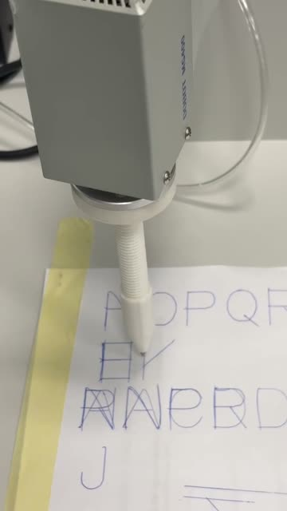

# Nutikad Lahendused / Smart Solutions

Kursusel ühendame ekraaniga mikrokontrolleri **AtomS3R**, kohaliku arvuti ehk **jaama** ja **Dobot MG400** roboti. Esimeses laboris valisime tähe Atomi nupuga. Jaama Pythoni programm teisendas tähe liikumisteeks ja MG400 joonistas selle 3D-prinditud pastakahoidikuga paberile. Teises laboris lisasime **avaliku HTTPS-postkontori**. See on Flaski veebiteenus, kuhu kasutaja jätab lubatud töö ja kust Atom saab tööd küsida ning tulemuse tagastada.

## Kontrollitud tulemused

### Labor 1 · täht Atomi nupult paberile

03.10.2026 joonistas MG400 päris katses meeskonna initsiaalid **D, N ja R**. Pärast lehe ümberkalibreerimist mõõtis Denys tähekõrguseks **20 mm**. Android-telefon avas Atomi Wi-Fi avalehe automaatselt ning telefonist saadetud 128 × 128 pilt ilmus Atomi ekraanile. [Joonistuse mõõtmised](smart-solutions/lab1/docs/letters.md) · [Jaama sündmuslogi](smart-solutions/lab1/data/letter_events.csv) · [Androidi katse](smart-solutions/lab1/docs/atom_page.md).

[](smart-solutions/lab1/docs/videos/atom-letter-robot-draws.mp4)

[Video (19 s)](smart-solutions/lab1/docs/videos/atom-letter-robot-draws.mp4) · [Robot ja pastakahoidik](smart-solutions/lab1/docs/images/robot-drawing-letters.jpg) · [Tähed joonlaua kõrval](smart-solutions/lab1/docs/images/robot-drawing-letters-ruler.jpg) · [Lähivaade](smart-solutions/lab1/docs/images/robot-drawing-letters-closeup.jpg).

### Labor 2 · avalik server ja kohalikud Atomi katsed

| Katse | Tulemus ja tõend |
| --- | --- |
| Avalik postkontor, 20.10.2026 | Nikita Teterev kontrollis HTTPS-i (`/health` vastas HTTP 200) ja sisselogimist telefoni 5G ühenduse kaudu. Töö `letter A` aegus ootejärjekorras. SQLite'i kirje säilis teenuse taaskäivitamisel ning Nikita taastas selle varukoopiast eraldi testbaasi. [Paigaldus ja kontrollid](smart-solutions/lab2/deploy/README.md). |
| Atomi BENCH ja HEALTH_ONLY, 23.10.2026 | Asendus-AtomS3R-i BENCH-katses töötas LCD ja avanes kirjutuskaitstud seadistusleht. HEALTH_ONLY katses õnnestusid Wi-Fi ja TLS, kuid päring lõppes teatega `HEALTH ERROR`. Autenditud polling avalikus serveris on kontrollimata. [Katsekanded](smart-solutions/lab2/README.md) · [Püsivara režiimid](smart-solutions/lab2/firmware/README.md). |
| Atomi LCD, 06.11.2026 | Kasutaja kinnitas ühel füüsilisel AtomS3R-il L2-pildi ja rohelise linnukese. Atom küsis töid kohalikult HTTP-testserverilt ja mõlemad sama tüüpi `display_image` tööd lõppesid olekuga `done / local_display`. [Katseraport](smart-solutions/lab2/docs/display_image_evidence.md) · [L2-pildi foto](smart-solutions/lab2/docs/evidence/atoms3r-lab2-logo-2026-11-06.jpg) · [Linnukese foto](smart-solutions/lab2/docs/evidence/atoms3r-lab2-check-2026-11-06.jpg). |
| Atomi võrk ja serveri ligipääs, 13.11.2026 | Atomi `/state` ja `/settings` vastasid telefoni pääsupunkti võrgus. Kohalik testpostkontor sel ajal ei töötanud. Raimo kinnitas oma kontoga SSH-sisselogimist avalikku serverisse. [Arenduspäevik](smart-solutions/lab2/README.md). |

Lab 2 päevik eristab varasemat musta ekraaniga AtomS3R-i ja asendus-AtomS3R-i. LCD-katse raport kirjeldab ühe seadmega tehtud katset. Seadmete praegune püsivara vajab kohapeal kontrollimist. [Varasema seadme diagnostika](smart-solutions/lab2/docs/atom_display_diagnostic.md).

## Laborid 1–3

| Labor ja eesmärk | Füüsiline või väliskeskkonnas kontrollitud tulemus | Tarkvaras kontrollitud | Lahtine töö |
| --- | --- | --- | --- |
| [1 · Kohalik joonistusjaam](smart-solutions/lab1/README.md) | Atomi nupult valitud täht jõudis USB kaudu jaama ja MG400 joonistas selle. Demo on lõpetatud, esitamise tag on `smart-solutions-lab1`. | Täheplaanid, kalibratsiooni kontroll ja jaama kuivkäivitus. | Hilisema füüsilise `source → finished` katse lõppkoordinaadid puuduvad repost. `positions.json` ja `pick_test.csv` pärinevad varasemast ühe punkti tõstekatsest. |
| [2 · Internetipostkontor ja kaks kaamerat](smart-solutions/lab2/README.md) | Avaliku HTTPS-serveri kontrollid, Atomi kohalik polling ja LCD-katsed ning BENCH ja HEALTH_ONLY piiratud tulemused. | Flaski järjekord, Atomi püsivara, station-adapter ja kaks kaameravoogu testallikatega. Läbitud tarkvaraline tervikahel `letter` ja `pick_place` näidistäituritega. | Avalik autentitud Atomi polling ja päris `letter` ahel jaamast MG400-ni. Mõlema päris kaamera ühiskatse, rõhukalibratsioon, latentsuse ja kaamerate mõõtmised ning katkestuskatsed. |
| [3 · Privaatne VPN, klapp ja UV](smart-solutions/lab3/README.md) | Riistvara- ja VPN-katsed on ootel. | WireGuardi plaan ja võrguühenduseta logianalüüs. Klapi, UV ja alarmi olekumudel ning sündmuste simulatsioon asuvad Lab 2 püsivaraprojektis. | Marsruudid, 48 tunni päris seire ja ühenduse katkemise ohutu käitumine. Klapi ja UV füüsiline juhtimine ning sõltumatu väljalülituse kontroll. |

## Süsteemi arhitektuur

```text
Lab 1  Atomi nupp → USB-jadaühendus → jaam → Ethernet → MG400
Lab 2  brauser → avalik HTTPS-postkontor ← Atomi väljaminev HTTPS-polling
       Atom → USB-jadaühendus → kohalik jaam → Ethernet → MG400
       lauakaamera → USB → jaam
       XIAO tööriistakaamera → kohalik IP-võrk → jaam
Lab 3  telefon ↔ privaatne WireGuard dropleti kaudu ↔ laborivõrk (plaan)
```

Lab 2 kavandatud tervikahelas küsib Atom postkontorilt korrapäraselt uusi töid (polling) ja saadab tulemuse tagasi. `display_image` kuvab pildi Atomi ekraanil. `letter` liigub jaama kaudu robotile. Avalik postkontor hoiab tööjärjekorda. Roboti liikumiskäsud ja kaameravood jäävad kohalikku võrku. Lab 3 WireGuardi plaan lisab volitatud seadmele eraldi ligipääsutee jaamale ja kaameratele. [Lab 1 katseskeem](smart-solutions/lab1/docs/system_03.10.26.svg) ([draw.io](smart-solutions/lab1/docs/system_03.10.26.drawio)) · [Lab 2 skeem](smart-solutions/lab2/docs/system.svg) ([draw.io](smart-solutions/lab2/docs/system.drawio)) · [WireGuardi plaan](smart-solutions/lab3/docs/wireguard/README.md).

## Kaustad

| Asukoht | Sisu |
| --- | --- |
| [Lab 1 `src/`](smart-solutions/lab1/src/) ja [`firmware/`](smart-solutions/lab1/firmware/) | Pythoni joonistusjaam, USB-sild ja MG400 klient. Atomi PlatformIO projektis on tähevalik, Wi-Fi avaleht, pildikuva ja pumba telemeetria. |
| [Lab 2 `server/`](smart-solutions/lab2/server/) ja [`deploy/`](smart-solutions/lab2/deploy/) | Flaski API ja veebileht, SQLite'i tööjärjekord ning Caddy, Gunicorni ja systemd paigaldusjuhised. |
| [Lab 2 `firmware/`](smart-solutions/lab2/firmware/) ja [`src/`](smart-solutions/lab2/src/) | Atomi polling, LCD ja USB-sild. Jaama adapter võtab USB kaudu töid vastu. Samas `src/` kaustas on näidistäiturid, kaameraserver ja [kaameraallikad](smart-solutions/lab2/src/cameras/). |
| [Lab 2 `firmware-xiao-camera/`](smart-solutions/lab2/firmware-xiao-camera/) | XIAO ESP32S3 Sense tööriistakaamera PlatformIO projekt. |
| [Lab 3 `docs/`](smart-solutions/lab3/docs/), [`data/`](smart-solutions/lab3/data/) ja [`tools/`](smart-solutions/lab3/tools/) | Võrgu- ja mõõteplaan, päiseridadega CSV-mallid ning tunneli logija ja analüüs. |
| Testid [Lab 1](smart-solutions/lab1/tests/), [Lab 2](smart-solutions/lab2/tests/) ja [Lab 3](smart-solutions/lab3/tests/) | Pythoni testid. Püsivara C++ testid asuvad Lab 2 [Atomi](smart-solutions/lab2/firmware/test/) ja [XIAO](smart-solutions/lab2/firmware-xiao-camera/test/) projektides. |

## Kiirstart ilma riistvarata

Ava terminal repo juurkaustas. Näited on macOS-i ja Linuxi jaoks ning kasutavad Python 3.11 või uuemat. Sõltuvused paigaldatakse ajutisse kausta. Pärast paigaldust töötavad näited ilma Atomi, MG400, kaamerate, päris võtmete ja tootmisserverita.

```sh
demo_dir=$(mktemp -d)
python3 -m venv "$demo_dir/venv"
"$demo_dir/venv/bin/python" -m pip install \
  -r smart-solutions/lab1/src/requirements.txt \
  -r smart-solutions/lab2/server/requirements.txt
```

Käivita samas terminalis. Iga `cd` sulgudes kehtib ainult selle näite käivituse ajal.

```sh
"$demo_dir/venv/bin/python" -B -m unittest discover -s smart-solutions/lab1/tests -p test_station_dry_run.py
(cd smart-solutions/lab2 && "$demo_dir/venv/bin/python" -B -m src.e2e_demo)
(cd smart-solutions/lab3 && "$demo_dir/venv/bin/python" -B -m unittest discover -s tests)
```

Lab 1 test näitab tähe liikumisplaani ja `accepted_dry_run` sündmust. Lab 2 näide loob ajutised SQLite'i andmebaasid ja tagastab mõlemale näidistööle `server_status: done` koos `hardware_used: false`. Lab 3 testid kasutavad sünteetilisi logiridu ja asendatud käsuvastuseid.

## Kaitsmisel

1. **Lab 1.** Näita videost nupuvajutust ja MG400 joonistust. Ava joonlauaga foto ning seo tulemus jaama sündmuslogi ja USB/Etherneti skeemiga.
2. **Lab 2.** Käivita kohalik näidis ja selgita töö teekonda järjekorrast tulemuseni. Näita LCD-fotosid ja avaliku serveri kuupäevaga kontrolli. Päris roboti integratsiooni eeldused on [letter-katse juhendis](smart-solutions/lab2/docs/live_letter_runbook.md), kaamerate omad [kaameraplaanis](smart-solutions/lab2/docs/cameras.md).
3. **Lab 3.** Näita WireGuardi plaanil telefoni ja laborivõrgu teed. Selgita, mida sünteetiliste andmetega testiti ja millised mõõtmised tuleb laboris koguda. [Mõõteplaan](smart-solutions/lab3/docs/measurements.md) · [Klapi ja UV plaan](smart-solutions/lab3/docs/atom_page.md).

## Seotud kursuseprojektid

- MG400 pastakahoidik, tööriistad ja kaamera mehaanika. [3D printimine ja CAD](https://github.com/Dennel04/3d-printing-course).
- Rõhuandur, pumba juhtimine ja mõõteandmete analüüs. [Andmehõive (Data Acquisition)](https://github.com/Dennel04/data-acquisition-course).

## Ohutus ja piirangud

- Päris MG400-ga tööta laboris kohaliku vastutajaga. Hoia tööala vaba ja füüsiline hädastopp käeulatuses. Korraga saadab liikumiskäske üks programm. Veebinupp ja võrguühenduse katkestamine ei asenda hädastoppi. [Lab 2 ohutus](smart-solutions/lab2/docs/safety.md) · [Lab 3 ohutus](smart-solutions/lab3/docs/safety.md).
- Tootmiskeskkonnas on kontrollitud postkontori HTTPS ja töö aegumine järjekorras. Avaliku serveri kaudu käivitatud **Atom → jaam → MG400** tervikahel ootab füüsilist kinnitust. Lab 2 `pick_place` piirdub näidistäituri, simulatsiooni ja eelkontrolliga. Kursuste ühise MG400 juhtimisõiguse mudel on tarkvaraprototüüp. See mudel ei piira programmide otseühendusi robotiga. [Pick-and-place'i piirid](smart-solutions/lab2/docs/pick_place_executor.md) · [Juhtimisõiguse prototüüp](smart-solutions/lab2/docs/ownership_gateway.md).
- XIAO varasem USB kaudu loetud JPEG kinnitab kaamera diagnostikakatset. Tööriistakaamera Wi-Fi voog ja mõlema päris kaamera ühiskatse on ootel. Lab 2 ja Lab 3 mõõte-CSV-des on ainult päised. [Kaamera tõendid ja mõõteplaan](smart-solutions/lab2/docs/cameras.md).
- VPN-i kaugliikumise eeldused on kogu lauda näitav kaamera, kohalik vastutaja ning rakendatud ja kohapeal kontrollitud katkestuskäitumine. UV on ette nähtud ainult kohalikuks kasutuseks läbipaistmatu katte all. Klapi ja UV tarkvaramudelid ootavad väljundite füüsilist kontrolli. [Lab 3 ohutus](smart-solutions/lab3/docs/safety.md).

## Venekeelsed tõlked

Mitteametlikud ülesannete tõlked ja õppemärkmed on kaustas [`study-ru/`](study-ru/README.md).

## English summary

Smart Solutions connects an AtomS3R, a local Python station and a Dobot MG400. Lab 1 demonstrated physical letter drawing. Lab 2 verified the public HTTPS job server and separate local Atom LCD tests. The public Atom-to-robot workflow and the physical `pick_place` executor remain unverified. Lab 3 has a WireGuard plan, offline monitoring tests and actuator models. Start with the hardware-free commands above.
