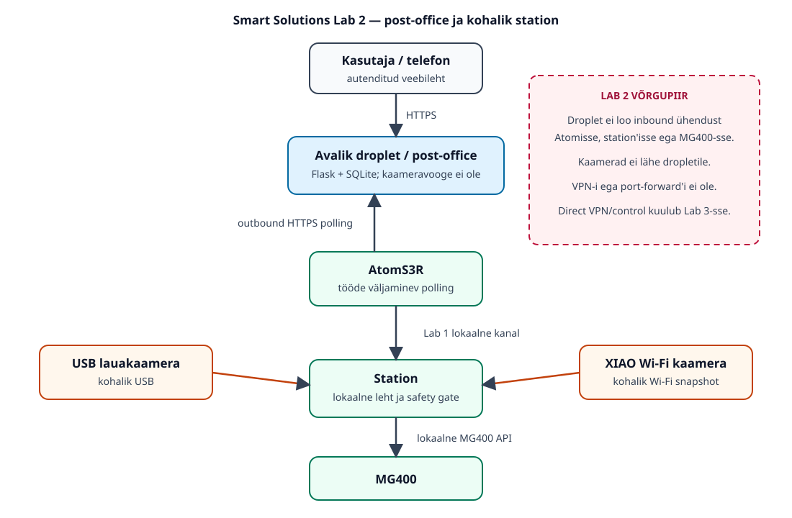

# Nutikad Lahendused: Labor 2 — internetipostkontor ja kaks kaamerat

**Töömaht:** 28 tundi | **Hindamine:** 20 punkti | **Meeskond:** 3 tudengit

**Välja antud:** 07.10.26 | **Tellimise kuupäev:** 16.10.26 | **Esimene kaitsmine:** 29.10.26, veebis

[Õppejõu ülesanne ja hindamiskriteeriumid](https://github.com/KKallas/Narva-subjects/blob/main/EST/2026-27/Smart%20Solutions/Smart%20Solutions%20%5BLab%202%5D%20EST.md).

## Ülevaade

Laboris 1 valiti täht Atomi nupuga ja kohalik jaam edastas töö Dobot
MG400-le. Labor 2 lisab **avaliku HTTPS-postkontori** ehk veebiteenuse,
kuhu kasutaja jätab lubatud töö ja kust ta näeb hiljem tulemust.
**AtomS3R** on ekraaniga mikrokontroller, mis küsib ise korrapäraselt uusi
töid. Seda nimetatakse pollinguks. Töö võib oodata järjekorras kuni
kehtivusaja (TTL) lõpuni. **Jaam** on laboriarvuti, mis vahendab robotitööd
ja kuvab kohalikke kaamerapilte.

[Praegune seis](#praegune-seis-13112026) · [Tõendid](#tõendid-ja-tulemused) ·
[Arhitektuur](#süsteemi-arhitektuur) · [Kiirstart](#kiirstart-ilma-riistvarata) ·
[Kaitsmine](#kaitsmise-juhend) · [Kontrollnimekiri](#kontrollnimekiri) ·
[Arenduspäevik](#arenduspäevik).

| Töö | Mida kasutaja tellib | Teostuse seis |
| --- | --- | --- |
| `letter` | Ühe tähe A–Z joonistamine Labori 1 jaama kaudu. | Tarkvaraline tervikahel on kontrollitud näidistäituriga. Lab 2 postkontorist päris MG400-ni ulatuv katse on ootel. [Katse eeldused](docs/live_letter_runbook.md). |
| `display_image` | Ühe püsivarasse ehitatud pildi kuvamine Atomi LCD-l. Valikud on `lab2_logo` ja `lab2_check`. | Mõlemad valikud on ühel päris Atomil kohaliku HTTP kaudu kontrollitud. Avalik HTTPS-ahel on ootel. [LCD-katsete raport](docs/display_image_evidence.md). |
| `pick_place` | Eelmääratud `source_to_finished` tööjada, mis viiks detaili lähtekohast lõppkohta. | Olemas on näidistäitur, simulatsioon ja eelkontroll. Päris täitja, pumba ja haarde kontroll on ootel. [Täitja piirid](docs/pick_place_executor.md) · [Simulatsioon](docs/pick_place_simulation.md). |

Kaitsmiseks valitud tööliigid on `letter` ja `display_image`. Kaks LCD-pilti
on ühe tööliigi kaks sisendit. Postkontor võtab vastu ainult lubatud
tööliike ja argumente. Koordinaadid, liikumiskäsud ja pildi URL-id lükatakse
tagasi. [API leping](docs/server_api.md#whitelist).

## Praegune seis (13.11.2026)

- **Avalik postkontor.** 20.10 kontrolliti HTTPS-i ja sisselogimist telefoni
  5G kaudu. `letter A` aegus järjekorras, selle kirje säilis teenuse
  taaskäivitamisel ja taastati varukoopiast eraldi testbaasi. Atomi
  autentitud HTTPS-polling ja kogu dropleti taaskäivituse katse on ootel.
  [Paigalduse kontrollid](deploy/README.md#kinnitatud-deployment-kontrollid--20102026).
- **Atomi eraldi katserežiimid.** 23.10 töötas asendusseadmel BENCH-i
  kirjutuskaitstud seadistusleht ja kolm kirjutuspäringut said HTTP 423.
  HEALTH_ONLY katses õnnestusid Wi-Fi ja TLS, kuid `/health` lõppes
  teatega `HEALTH ERROR`. HTTP 200 ja oodatud JSON jäid kinnitamata.
  [Püsivara ja katsed](firmware/README.md#ehitus-ja-hostitestid) ·
  [Varasema seadme ekraanidiagnostika](docs/atom_display_diagnostic.md).
- **Ühe füüsilise AtomS3R-i katsed.** 06.11 töötasid NORMAL-püsivaraga
  seadmel kohaliku HTTP kaudu autentitud polling ja mõlemad LCD-kuvad.
  NORMAL-is seadistati testühendus. Seadete, testinuppude ja NVS-i
  püsivuse terviklik kontroll on ootel.
  13.11 näitas sama MAC-iga Atom Redmi võrgus olekut `sta_connected`.
  `GET /state` ja `GET /settings` õnnestusid ning aktiivse töö ja ootel
  tulemuse ID-d olid tühjad. Kohalik server ei kuulanud pordil 5001,
  seega oli `poll_failed` ootuspärane. Iga seadme püsivara ja ühendus
  tuleb enne uut katset kohapeal üle kontrollida.
  [LCD-katsete raport](docs/display_image_evidence.md) · [13.11 kanne](#arenduspäevik).
- **SSH-ligipääs.** 13.11 logis Nikita dropletisse sisse ja Raimo kinnitas
  isiklikult ligipääsu oma sudo-õiguseta kontole. Ülejäänud liikmete
  isiklik ligipääs on kontrollimata. [SSH kontrollid](deploy/README.md#ligipääs-ja-avalik-https-kontrollitud).
- **Tarkvarakontrollid.** Postkontori järjekord, jaama adapter,
  `letter` ja `pick_place` näidisahelad ning kahe kaameravoo kuva
  testallikatega on kontrollitud. Päris robotitöö, mõlema füüsilise kaamera
  ühiskatse ja rõhuanduri mõõtmised on ootel.
  [Testitulemused](#tarkvaralise-kontrolli-tulemused).

## Tõendid ja tulemused

| Tõend | Mida saab selle põhjal öelda | Kust vaadata |
| --- | --- | --- |
| Päris Atomi LCD ja kohalik HTTP, 06.11.2026 | Kasutaja nägi L2-pilti ja rohelist linnukest. Mõlemad tööd lõppesid olekuga `done / local_display`. Raport seob töö ID-d HTTP-vastuste ja testbaasi kirjetega. | [Raport](docs/display_image_evidence.md#kinnitatud-füüsilised-tulemused) · [L2-pildi foto](docs/evidence/atoms3r-lab2-logo-2026-11-06.jpg) · [Linnukese foto](docs/evidence/atoms3r-lab2-check-2026-11-06.jpg) |
| Avalik server, 20.10.2026 | Väline `/health` andis HTTP/2 200. `deploy/verify.sh` andis 12 PASS, 0 FAIL, 0 SKIP. Taastatud SQLite'i testbaasis oli töö kirje olemas. | [Kontrollide tabel](deploy/README.md#kinnitatud-deployment-kontrollid--20102026) · [Kontrollskript](deploy/verify.sh) |
| Atomi BENCH, 23.10.2026 | Kolm POST-päringut andsid HTTP 423. Andurita G5 sisendilt loeti `raw_adc=7`. Pinge ja rõhk jäid määramata. | [BENCH-katse](firmware/README.md#kinnitatud-bench-katse--23102026) |
| XIAO USB diagnostika, 23.10.2026 | 3D Printing Lab 2 katses saadi üks 1600 × 1200 JPEG USB Seriali kaudu. Siinse XIAO Wi-Fi püsivara voog ja vaateväli ootavad katset. | [Diagnostika ja kaameravalik](docs/cameras.md#kinnitatud-lähtefaktid-ja-püsivara-valik) · [XIAO projekt](firmware-xiao-camera/README.md) |
| Tarkvaraline tervikahel | `letter` ja `pick_place` jõuavad sama töö ID-ga järjekorrast tagasi serverisse olekuga `done` ja tunnusega `hardware_used: false`. | [Demo lähtekood](src/e2e_demo.py) · [Postkontori testid](tests/test_post_office.py) · [Kaameratestid](tests/test_cameras.py) |
| Füüsiliste mõõtmiste ootel mallid | Kõigis neljas CSV-s on ainult päised. LCD-katse ajatemplid ja sünteetilised FPS-loendurid ei anna roboti latentsust ega päris kaamerate mõõteandmeid. | [Kiire polling](docs/latency_poll_fast.csv) · [Aeglane polling](docs/latency_poll_slow.csv) · [Kaamerad](docs/camera_metrics.csv) · [Juhtimislatentsus](docs/control_latency_cameras.csv) |

## Süsteemi arhitektuur

Skeem näitab kavandatud ühendusi. Katsetatud osad on kirjeldatud allpool.

```text
Brauser → HTTPS → avalik postkontor ← väljaminev HTTPS-polling ← AtomS3R
AtomS3R → sisseehitatud pilt → LCD
AtomS3R → USB-jadaühendus → kohalik jaam → Ethernet → MG400
Verbatim lauakaamera → USB → jaam
XIAO tööriistakaamera → kohalik IP-võrk (Wi-Fi) → jaam
```

- **Avalik pool.** Caddy teenindab HTTPS-i. Gunicorn käitab Flaski
  loopback-aadressil ja SQLite hoiab järjekorda, töö tulemusi ning Atomi
  viimase pollingu aega (`last_seen`). Atom algatab ühenduse ise ja tagastab
  tulemuse sama töö ID-ga. Avalik server ja Atomi kohalik HTTP-rada on
  eraldi kontrollitud. [Paigaldus](deploy/README.md#arhitektuur-ja-piir) ·
  [API](docs/server_api.md).
- **Kohalik pool.** Pilditöö lõpetab Atom oma LCD-l. Robotitöö kavandatud
  rada läbib USB kaudu jaama adapteri ja Labori 1 jaama. Adapteri
  püsiv tööolek aitab vältida ebaselge töö korduskäivitust. SQLite'i
  juhtimisõiguse mudel on tarkvaraprototüüp ja programmide otseühendused
  MG400-ga jäävad selle ulatusest välja. Päris ühine juhtimisvärav on
  kavandatud. [Adapter](src/station_adapter.py) · [Juhtimisõiguse mudel](docs/ownership_gateway.md).
- **Kaamerad ja järgmine labor.** Verbatim näitab plaani järgi kogu lauda
  ja robotit. XIAO näitab otsikut ning selle all olevat detaili. Jaam
  küsib XIAO-lt kohalikke JPEG-kaadreid ja kuvab mõlemat voogu.
  Jaama brauseris on see kontrollitud testallikatega. Päris jaama IP-teekond
  XIAO-ni, toide, kaablitee, vaateväljad ja kaitstud LAN-vaade on ootel.
  Vood jäävad kohalikku võrku. Lab 3 kavandab eraldi privaatse VPN-i tee
  jaamale ja kaameratele. [Kaamerad](docs/cameras.md) · [Lab 3 sõltuvused](../lab3/README.md#smart-solutions-lab-2).



[Muudetav draw.io skeem](docs/system.drawio).

## Kiirstart ilma riistvarata

Ava macOS-i või Linuxi terminal repo juurkaustas. Vaja läheb Pythonit
(3.11 või uuem). Paigalda sõltuvused enne kaitsmist. Käivita ülejäänud
käsud samas terminalis, nüüd juba Lab 2 kaustas.

```sh
cd smart-solutions/lab2
demo_dir=$(mktemp -d)
python3 -m venv "$demo_dir/venv"
demo_python="$demo_dir/venv/bin/python"
"$demo_python" -m pip install -r server/requirements.txt 'requests>=2.32,<3'
```

### Kohalik järjekord brauseris

Käivita testserver esiplaanil. Port 5001 peab olema vaba. Ava brauser alles
siis, kui Flask teatab käivitumisest aadressil `http://127.0.0.1:5001`.
Server kasutab uut ajutist SQLite'i ja avalikke näidisväärtusi ainult
selleks demoks.

```sh
env POST_OFFICE_BIND=127.0.0.1 \
  POST_OFFICE_DB="$demo_dir/queue.sqlite3" \
  POST_OFFICE_USER=demo-user POST_OFFICE_PASSWORD=demo-password \
  ATOM_API_KEY=demo-atom-key "$demo_python" -B -m server.app
```

Ava [kohalik postkontor](http://127.0.0.1:5001/) ja logi sisse kasutajaga
`demo-user`, parooliga `demo-password`. Vali „Joonista täht“, sisesta
`A`, määra TTL-iks 30 sekundit ja loo näidistöö. Näita tööde ajaloos
ID-d ja olekut `queued`. Pärast 30 sekundi möödumist värskenda lehte,
et näha olekut `expired` ja põhjust `ttl_expired`.
Seejärel peata server klahvidega Ctrl+C. [Serveri lähtekood](server/app.py).

### Tarkvaraline tervikahel

```sh
"$demo_python" -B -m src.e2e_demo
```

Demo loob oma ajutised andmebaasid. Flaski testklient ja näidistäiturid
läbivad ahela postkontor → simuleeritud Atom → jaama adapter → tulemus
ilma võrgu või jadapordita. Leia JSON-ist mõlema töö `job_id` ja võrdle
seda `station_result.id` väärtusega. Oodatav serveriolek on `done` ja
`hardware_used` on `false`. [Demo lähtekood](src/e2e_demo.py).

### Kahe kaameravaate näidis

```sh
"$demo_python" -B -m src.camera_server --mock --host 127.0.0.1 --port 5002
```

Ava [kohalik kaameraleht](http://127.0.0.1:5002/) ja näita mõlemat
sünteetilist voogu. Peata server klahvidega Ctrl+C.
[Kaameraserveri lähtekood](src/camera_server.py).

## Kaitsmise juhend

See 7-minutiline näidis tutvustab dokumenteeritud seisu. Ametlik kaitsmine
kestab 15 minutit ja hõlmab päriskatseid.
[Õppejõu kaitsmisjuhend](https://github.com/KKallas/Narva-subjects/blob/main/EST/2026-27/Smart%20Solutions/Smart%20Solutions%20%5BLab%202%5D%20EST.md#kaitsmine).

Enne alustamist valmista ette terminal ja ava brauseris selle README,
LCD-raport ning paigalduse kontrollitabel. Käivita kohalik postkontor
[kiirstardi järgi](#kiirstart-ilma-riistvarata).

| Aeg | Mida näidata | Mida see tõendab |
| --- | --- | --- |
| 0:00–1:00 | Ava skeem ja osuta avaliku serveri, Atomi ja kohaliku jaama piirile. | Kasutaja jätab töö järjekorda ja Atom küsib seda väljamineva ühendusega. |
| 1:00–2:30 | Loo kohalikus UI-s üks `letter A`. Näita ID-d ja olekut `queued`, seejärel pärast TTL-i olekut `expired`. Näita ka `display_image` valikut. | Veebivorm, kohaliku järjekorra kirje ja aegumine. |
| 2:30–3:30 | Peata testserver ja käivita `src.e2e_demo`. Võrdle töö ID-sid ja näita `done` ning `hardware_used: false`. | Töö ja tulemus läbivad tarkvaraahela näidistäituriga. |
| 3:30–5:00 | Ava LCD-raport, töö ID-d ja mõlemad fotod. Seejärel ava 20.10 serverikontroll. | Kohalik HTTP ja füüsiline LCD on kinnitatud ühe seadme kahe pilditööga. Avalik HTTPS ja TTL on kinnitatud eraldi serverikatses. |
| 5:00–6:00 | Käivita kaameraserver käsuga `--mock` ja ava kaks vaadet. | Kohalik vaade kahe sünteetilise vooga. |
| 6:00–7:00 | Ava kontrollnimekiri ja 13.11 päevikukanne. Too välja katsete ohutuseeldused ning täitmata punktid. | Tõendid on kuupäevastatud ja järgmised katsed on jälgitavad. |

## Puuduvad katsed ja järgmised sammud

### Enne füüsilist robotikatset

1. Kinnitada kohalik vastutaja, füüsilise hädastopi kättesaadavus, vaba
   tööala, kogu tööala nähtavus üldkaameras ja meeskonna ohutuskokkulepe.
   Kontrollida kohapeal, et MG400 käske saadab korraga ainult üks programm.
   [Ohutuskokkulepe](docs/safety.md) · [Letter-katse eeldused](docs/live_letter_runbook.md#enne-käivitamist).
2. Kontrollida seadme režiimi, USB-ühendust, järjekorra seisu ja jaama
   valmisolekut kohapealse katsejuhendi järgi. Kontrollida Verbatimi ja XIAO
   kinnitust, kaableid, vaatevälja ja kohalikku võrguühendust.
   [Kaamerate kontrolliplaan](docs/cameras.md#labori-kontrolliplaan).

### Järgmised tõendid

1. Kinnitada Atomi autentitud avalik HTTPS-polling, `last_seen` ja
   offline-olek ning `display_image` tulemus avaliku ahela kaudu. Korrata
   päris Atomiga TTL-i ja lubamatu töö kontrolli.
   [Atomi järgmised katsed](docs/display_image_evidence.md#minimaalne-järgmine-kodune-kontroll).
2. Pärast ohutuseelduste täitmist kinnitada `letter`-töö tervikahel ja
   teha kolm kontrollitud internetikatkestuse katset aktiivse töö ajal.
   Atomi taaskäivitus ja saatmata tulemuse kordussaatmine vajavad oma
   kontrolli. [Tulemused ja katkestused](docs/live_letter_runbook.md#tulemused-ja-katkestused).
3. Mõõta kaks 30 tööga pollingu latentsusseeriat. Esitada kummagi keskmine,
   maksimum ja pollingute arv tunnis ning võrrelda Labori 1 tulemusega.
   Kinnitada mõlemad päris kaameravaated ja mõõta viide, FPS, ribalaius
   ning juhtimislatentsus 0, 1 ja 2 kaameraga.
   [Mõõtefailid](#tõendid-ja-tulemused) · [Kaamera mõõtemetoodika](docs/cameras.md#tulevane-mõõtmismetoodika).
4. Viia Andmehõive kalibratsioon Atomi lehele ja kontrollida toorest ADC-d,
   pinget ja kPa-d sama prooviga. Kontrollida ülejäänud SSH-ligipääsud,
   dropleti taaskäivitus ja täielik taastamine, BOM ning esitamise tõendid.
   [Atomi leht](docs/atom_page.md) · [Paigaldus](deploy/README.md) · [BOM](docs/bom.md).

## Püsivara töövoog

AtomS3 püsivara arendatakse, ehitatakse ja laaditakse seadmesse PlatformIO
abil. Lab 2 muudatused peavad jääma reprodutseeritavasse PlatformIO projekti:
`platformio.ini`, lähtekoodipuu ja fikseeritavad sõltuvused. Arduino IDE ei
ole selle repo peamine projektitöövoog.

XIAO ESP32S3 Sense tööriistakaamera on eraldi PlatformIO projektis
`firmware-xiao-camera/`; see ei ole AtomS3 projektiga kokku segatud. Mõlemal on
oma `platformio.ini`, lähtekoodipuu ja native-testid. Lab 2 AtomS3 projekt on
kaustas `firmware/`; Labori 1 püsivara ei ole tervikuna kopeeritud. Mõlema
projekti `pio run` build on tarkvaraliselt kontrollitud. AtomS3R-i Lab 2
püsivara laaditi 12.10.26 PlatformIO-ga seadmesse; Atomi autentitud lokaalne
polling, reboot-persistence ja Wi-Fi reconnect kontrolliti 13.10.26. Selle
repo XIAO Wi-Fi firmware upload ja ülejäänud integratsioonikatsed on TODO.

## Tehtud töö

See jaotis võtab kokku repos tegelikult valminud ja tarkvaraliselt kontrollitud
Lab 2 osad ning 16.10.26 ja 20.10.26 dropleti kontrollid. Roboti ja
kaamerate füüsilised katsed jäävad lahti; Atomi varasemad katsed on eraldi
kuupäevaga kirjas.

### Postkontori server

- Valmis on Flaski ja SQLite'i kasutav postkontor, kus autentitud kasutaja saab
  luua lubatud kõrgtaseme `letter`, `display_image` ja `pick_place` töid.
  Lubatud argumendid on kirjas [API lepingus](docs/server_api.md#whitelist).
- Atomil on kasutajaliidesest eraldatud bearer-võtmega polling- ja tulemuse API.
- Server rakendab TTL-i ja aegumist, lubatud tööde whitelist'i, atomaarset
  claim'i ning idempotentset tulemust. Tundmatuid töid, otseliikumiskäske ja
  kasutaja antud trajektoore järjekorda ei lubata.
- SQLite'is säilivad töö, tulemus ja Atomi `last_seen` olek. Sama töö
  kordussaatmine ei käivita kontrollimatut uut täitmist.
- Sama API-ga mock Atom võimaldab serveri töövoogu kontrollida ilma AtomS3R-i,
  station'i või MG400-ta. Serveri käitumine on kaetud Python testidega.
- Nikita paigaldas serveri päris dropletile 16.10.26. Ta kontrollis 20.10.26
  avalikku HTTPS-i, login'it Macis ja telefonis 5G kaudu, `letter A` loomist
  ja aegumist ning kirje säilimist teenuse restardi järel. Atom oli offline;
  robotitöö täitmist selle katsega ei kontrollitud.

### AtomS3R Lab 2 püsivara

- Kaustas `firmware/` on PlatformIO projekt: environment `atoms3r` kasutab
  ühilduvat `m5stack-atoms3` board definition'it.
- Seadete mudel sisaldab serveri URL-i, Atomi privaatvõtit ja polling-intervalli.
  Rakendatud on väljaminev poll/result klient ning production-siht kasutab
  HTTPS-i.
- Aktiivse töö ID ja saatmata terminaltulemus säilitatakse püsivalt. Ühe
  aktiivse töö piir, duplikaadikaitse ja restardi järel ebaselge claim'i
  fail-safe käitumine väldivad automaatset kordustäitmist.
- Atom → station piir säilitab `letter` jaoks Lab 1 väljadega ühilduva
  serial-JSON sõnumi ning saadab `pick_place` jaoks ainult high-level routine'i;
  mõlemal on stabiilne `job_id`. Native-testid ja PlatformIO build läbivad.
- Lab 2 püsivara laaditi 12.10.26 füüsilisse AtomS3R-i pordi
  `/dev/cu.usbmodem101` kaudu. Esimesel katsel leitud NVS `activeId NOT_FOUND`
  kordus ja development-serveri loopback-bind parandati ning kontrolliti sama
  päeva jätkukatses. Setup-AP, settings, autentitud lokaalne polling,
  reboot-persistence ja Wi-Fi reconnect kontrolliti päris seadmel 13.10.26;
  production HTTPS, station/MG400 ja ametlik mid-job katkestus on TODO.

### Station-adapter

- Valmis on station'i Atom-job adapter, mis eristab `letter` ja `pick_place`
  töid, säilitab `session/seq/atom_sent_ms` väljad ning serveri stabiilse
  `job_id`.
- SQLite'i idempotentsus, `session + seq` duplikaadikaitse ja restardi
  `ambiguous_after_restart` fail-safe väldivad ebaselge töö automaatset
  korduskäivitust.
- USB serial transport on eraldi abstraktsioon. Eraldi letter- ja pick-place
  mock executor'id võimaldavad software-only kontrolli; vaikimisi on täitmine
  keelatud.
- Adapter ei loo MG400 ühendust ega impordi robotiklienti. Kohalik software E2E
  läbib kogu server → mock Atom → station → server tulemuse ahela.
- Päris MG400 täitmine on TODO ja vajab eraldi lokaalset ohutuskontrolli.

### Station'i kaamerad

- Valmis on ühine kaameraabstraktsioon, USB OpenCV backend ja XIAO HTTP
  snapshot backend.
- Eraldi `src.camera_server` leht näitab kahte kaamerat ning pakub snapshot- ja
  MJPEG route'e. Vaikebind on `127.0.0.1:5002`, autentimist ei ole. Lab 1
  station'i leht kuvab seda kahe kaameraga iframe'is; mõlemad protsessid
  jäävad loopback'ile. Kaitstud LAN-ligipääs on TODO. Mock-kaamerad
  võimaldavad mõlemat rada riistvarata testida.
- Tarkvaralised loendurid mõõdavad kaadrite arvu, väljastatud baite ning
  arvutatud FPS/Mbit/s väärtusi; need ei ole füüsiliste kaamerate mõõtetulemused.
- Kaamerakiht ja route'id on kaetud testidega. Päris USB- ja XIAO-kaameraid ei
  ole selle Lab 2 töövooga füüsiliselt kontrollitud.

### XIAO ESP32S3 Sense

- Kaustas `firmware-xiao-camera/` on eraldi PlatformIO projekt ametliku
  `seeed_xiao_esp32s3` boardiga.
- Teostatud on camera init alus, toetatud sensori tuvastamine, PSRAM-i arvestav
  seadistus, piiratud Wi-Fi reconnect/backoff ning endpoint'id `/status` ja
  `/snapshot.jpg`.
- HTTP leping sobib station'i XIAO snapshot backendiga. PlatformIO build ja
  native-testid läbivad.
- Lab 2 põhipüsivara on `firmware-xiao-camera/`, kohalik Wi-Fi HTTP
  `GET /snapshot.jpg`. **Selle püsivara upload ja Wi-Fi töö on kinnitamata.**
- [3D Printing Lab 2](https://github.com/Dennel04/3d-printing-course/blob/main/3d-print/lab2/README.md)
  kinnitab 23.10.26 J4 kinnituses XIAO OV3660 ühe JPEG-i `1600 × 1200`
  saamist USB Serial COM5 kaudu. Sealne `tool-camera/firmware/` jääb
  diagnostiliseks varuks, mitte selle Wi-Fi lahenduse kinnituseks.
  J4 paigutus on meeskonna dokumenteeritud variant, mille kohta 3D Printing
  kirjeldab õpetaja suulist luba. Verbatim AWC-03 (49580) on üldvaatekaamerana
  identifitseeritud; lõplik paigaldus, kogu laua FOV ja mõõtmised on TODO.

### Dropleti paigalduse alus

- Valmis on olemasoleva Flaski rakenduse Gunicorn WSGI entrypoint, localhosti
  bind'iga systemd unit ja Caddy HTTPS reverse proxy näidis.
- Lisatud on placeholder'itega env/saladuste muster ning install-, update-,
  verify- ja backup-skriptid. SQLite asub kavandis lähtekoodipuust väljas ning
  backup kasutab SQLite'i turvalist backup API-t.
- Paigalduse staatilised ja lokaalsed testid kontrollivad muu hulgas localhost
  bind'i, fail-closed saladusi, Caddy piiri ja backup'i terviklikkust.
- Nikita käivitas 16.10.26 päris dropletil `deploy/install.sh` ning seejärel
  systemd teenuse käsitsi. Env-faili õigused, SQLite fail, loopback-bind,
  HTTP 200 health ja autentimata HTTP 401 on kontrollitud.
- Nikita kontrollis 20.10.26 Caddy avalikku HTTPS-i, SSH autentimisseadeid,
  UFW-d ja teenuste `enabled/active` olekut. `deploy/verify.sh` andis
  `12 PASS, 0 FAIL, 0 SKIP`; SQLite backup ja taastamine eraldi testbaasi
  läbisid. Kogu dropleti reboot ja täielik taastamine puhtale hostile on TODO.

## Tarkvaralise kontrolli tulemused

Tabel koondab kuupäevaga dokumenteeritud tarkvarakontrollid.
Püsivara seadmekatsed on eraldi [tõendite tabelis](#tõendid-ja-tulemused).

| Kontroll | Tegelik tulemus | Piirang |
| :--- | :--- | :--- |
| Lab 2 regressioon, 06.11.2026 | pytest 888 läbis, 1 vahele jäetud. Atomi native-testid 72/72. NORMAL, BENCH ja HEALTH_ONLY buildid SUCCESS. | [Kuupäevaga päevikukanne](#arenduspäevik) |
| Lab 2 Python `pytest` | 23.10.26 pärast HEALTH_ONLY lisamist: 541 testi läbis | software-only |
| `python -m src.e2e_demo` | `letter` ja `pick_place`: `server_status=done`, sama `job_id` kogu ahelas, `hardware_used=false` | ajutine DB, mock Atom ja mock executor |
| AtomS3R `pio run -e atoms3r` | 23.10.26: BENCH_MODE=1 puhas build SUCCESS | lokaalne build; tavaline postkontoriklient on sellest build'ist väljas |
| AtomS3R `pio test -e native` | 23.10.26: 57/57 testi läbis (43 olemasolevat ja 14 HEALTH_ONLY) | hosti native-testid, mitte seadme test |
| `pio run -e atoms3r_health` ja ELF verifier | SUCCESS; RAM 49 112 B, flash 982 297 B; isolation ja CA PASS | lokaalne build; flash-coredump jääkrisk säilib; päris `/health` katse lõppes veaga |
| XIAO `pio run` | SUCCESS, board `seeed_xiao_esp32s3` | build; upload'i ei tehtud |
| XIAO `pio test -e native` | 6/6 testi läbis | hosti native-testid, mitte kaamerakatse |
| Deployment-testid | 18 testi läbis | lokaalne/static ja mock readiness-kontroll; päris hosti ei kasutatud |
| WSGI import ja deploy shell syntax | läbis | lokaalne/static kontroll |
| `deploy/verify.sh` arendusmasinas | `SKIP` | systemd/Caddy production-kontroll vajab päris Ubuntu dropletit |
| Mock-kaameraserver | HTTP 200 lehel, API-s ning table/tool snapshot'idel | sünteetilised mock-kaadrid, mitte füüsiline mõõtmine |

## Kontrollnimekiri

Kõik punktid on alguses lahti. Märge tehakse alles pärast kontrollitavat
tulemust; füüsilise katse juurde lisatakse kuupäev, meetod ja failiviide.

### Tarkvaraliselt ettevalmistatav

- [x] Postkontori kasutajaleht ja Atomi API on loogiliselt eraldatud.
- [x] Kohalik kasutajaleht nõuab autentimist; production-siht on endiselt HTTPS.
- [x] Postkontor võtab vastu ainult whitelist'is olevaid kõrgtaseme töid.
- [x] `letter` on lubatud ja tarkvaraliselt teostatud kõrgtaseme robotitöö.
- [x] `pick_place` on teine lubatud high-level töö software-only ahelas;
  ainus routine on `source_to_finished` ning internetist antud koordinaadid,
  kiirus, pumba-/DO-käsud ja trajektoorid lükatakse tagasi. Päris MG400/pumba
  kontroll on endiselt lahti, seega ametlik riistvarakriteerium ei ole täidetud.
- [x] Töödel on TTL; aegunud töö märgitakse `expired` ja seda ei väljastata.
- [x] Vigane või tundmatu töö lükatakse tagasi ega jõua täitmispiirini.
- [x] Stabiilne töö ID, atomaarne claim ja idempotentne tulemus välistavad
  sama töö kontrollimatu kordusväljastuse.
- [x] Atom API on väljamineva pollingu jaoks; droplet ei loo ühendust
  Atomi, jaama ega robotiga.
- [x] Poll uuendab heartbeat-/olekuinfot; leht näitab `last_seen` põhjal
  online/offline olekut, roboti olekut ja polling-intervalli.
- [x] Sama terminaltulemuse kordussaatmine sama töö ID-ga on serveris idempotentne.
- [x] Postkontori API leping on kirjas failis `docs/server_api.md`.
- [x] Kohalik Flask postkontor, SQLite store ja minimaalne kasutajaleht on teostatud.
- [x] Mock Atom kasutab sama HTTP API-t ja simuleerib lokaalse jaama tulemust,
  kuid ei kasuta AtomS3 ega MG400-t.
- [x] Automaattestid katavad autentimise, valideerimise, TTL-i, claim'i,
  idempotentsuse, tulemused ja `last_seen` oleku.
- [x] Atomi olemasoleva lehe Lab 2 väljad ja testid on kirjeldatud failis
  `docs/atom_page.md`.
- [x] AtomS3 PlatformIO projekt build'ib ning hostitestid katavad töö- ja
  konfiguratsioonivalideerimist ning ühe aktiivse claim'i reeglit.
- [x] Atom pollib millis-ajastusega, valideerib `letter` ja eelmääratud
  `pick_place` töö ning salvestab aktiivse ID ja saatmata terminaltulemuse
  püsivalt enne retry'd.
- [x] AtomS3 minimaalne seadeteleht salvestab serveri URL-i, bearer-võtme ja
  polling-intervalli; saladust ei tagastata ega logita.
- [x] Lab 2 station-adapter valideerib firmware serial-JSON lepingu ja kasutab
  Lab 1 `session + seq` korduskaitset koos stabiilse `job_id` väärtusega.
- [x] Station'i SQLite store säilitab terminaltulemuse ja muudab restardist
  jäänud poolelioleva töö `ambiguous_after_restart` keeldumiseks.
- [x] Mock executor ning lokaalne end-to-end demo kontrollivad server → mock
  Atom → station → server ahelat ilma AtomS3 või MG400-ta.
- [x] Ohutuskokkuleppe mustand on failis `docs/safety.md`.
- [x] BOM-i kontroll-leht on failis `docs/bom.md`.
- [x] Mõõtmiste CSV-mallid sisaldavad ainult päiseid, kuni päris mõõtmised on tehtud.
- [x] Station'i eraldi kohalik kaameraserver näitab kahte jagatud worker'iga
  MJPEG-allikat ning ei lisa kaameraroute'e dropleti postkontorisse.
- [x] Mock table/tool allikad, USB OpenCV backend ja seadistatava URL-iga XIAO
  snapshot backend on automaattestitavad ilma riistvarata.
- [x] Software kaadriloendurid ja väljastatud baitide/FPS/Mbit/s arvutus on
  valmis; need ei ole päris kaameramõõtmised.
- [x] XIAO ESP32S3 Sense tool-camera on eraldi PlatformIO projekt ametliku
  `seeed_xiao_esp32s3` boardiga; build ja native-testid läbivad.
- [x] XIAO `/status` ja `/snapshot.jpg` leping sobib station'i olemasoleva
  snapshot backendiga; Wi-Fi saladused jäävad ignored private header'isse.
- [x] Production-paigalduse tarkvaraalus sisaldab localhost Gunicorn unit'it,
  Caddy HTTPS reverse proxy näidist, kaitstud env-malli, SQLite backup'i ning
  install/update/verify skripte. Dropleti paigaldus, avalik HTTPS ja
  `deploy/verify.sh` on kontrollitud; Atomi production polling on TODO.

### Dropleti paigaldus ja production-kontroll

- [ ] Igal kasutataval arvutil on oma SSH võtmepaar; privaatvõtmeid ei jagata
  ega lisata reposse.
- [x] Nikita sai õppejõult dropleti ligipääsuandmed ja kontrollis võtmega
  SSH login'it 16.10.26.
- [x] Raimo kinnitas 13.11.2026 isiklikult, et sai oma võtmega dropletisse
  sisse logida. Tema kontol puudub sudo-õigus.
- [ ] Ülejäänud meeskonnaliikmete isiklik SSH-ligipääs on veel kontrollimata.
- [x] Repo on `/opt/smart-solutions-lab2/app`; production-sõltuvused ja
  systemd teenus on paigaldatud, teenus käivitati käsitsi 16.10.26.
- [x] Env-fail on `root:root 0600`, täidetud ning placeholder'iteta;
  veebiparool ja Atomi võti on eraldi paroolihalduris.
- [x] SQLite fail asub püsirajal; Gunicorn kuulas ainult `127.0.0.1:5001`,
  `/health` vastas HTTP 200 ning autentimata `/` HTTP 401 (16.10.26).
- [x] `smart-solutions-lab2` ja Caddy on `enabled` ning `active` (20.10.26).
- [ ] Teenuste käivitumine pärast kogu dropleti reboot'i on kontrollitud.
- [x] SSH: `pubkeyauthentication yes`, `passwordauthentication no`,
  `kbdinteractiveauthentication no`; sõltumatu võtmega login pärast UFW
  aktiveerimist kontrollitud. Ubuntu uuenduses paigaldati 11 paketi uuendused
  (20.10.26).
- [x] UFW on `active`, default `deny incoming`, sissetulevad TCP 22/80/443
  lubatud (20.10.26).
- [x] `https://narva2.roboarena.org` töötab kehtiva TLS-iga; väline Maci curl
  sai `/health` päringule HTTP/2 200 (20.10.26).
- [x] Kasutajalehe autentimine ja UI on Safari Macis ning Chrome telefonis
  5G kaudu kontrollitud (20.10.26).
- [x] Päris serveris loodud `letter A` aegus: `expired`, `ttl_expired`;
  SQLite kirje säilis teenuse restardi järel (20.10.26).
- [x] `deploy/verify.sh`: `12 PASS, 0 FAIL, 0 SKIP` (20.10.26).
- [x] SQLite backup (24 576 baiti, `root:root 0600`) taastati eraldi testbaasi:
  `integrity_check` oli `ok` ja töö kirje taastati (20.10.26).
- [ ] Atom pollib production-hostilt töid ning autentimine toimib seadmesse
  salvestatud võtmega, mida repos ei ole.
- [ ] Dropleti taastamine märkmete järgi on läbi proovitud ja tulemus dokumenteeritud.

### Vajab päris riistvara või laborikatset

- [ ] `letter` töö jõuab postkontorist Atomi ja Labori 1 kohaliku kanali kaudu
  jaama ning käivitab lubatud MG400 täitmisraja.
- [ ] Teine whitelist'i töö on kogu avalikus ahelas kontrollitud.
  `display_image` kohalik LCD-katse läbis 06.11.2026 mõlema pildiga
  ([tõendid](docs/display_image_evidence.md)); avalik HTTPS end-to-end on TODO.
- [ ] 30 sõnumit on mõõdetud kiire polling-intervalliga failis
  `docs/latency_poll_fast.csv`.
- [ ] 30 sõnumit on mõõdetud aeglase polling-intervalliga failis
  `docs/latency_poll_slow.csv`.
- [ ] Mõlema 30 katse seeria keskmine ja maksimum on arvutatud pärisandmetest.
- [ ] Internetiühendus katkestatakse töö ajal kontrollitud katses ning
  kontrollitakse, et station lõpetab juba vastu võetud tervikliku töö lokaalselt,
  Atom säilitab tulemuse ja saadab selle pärast ühenduse taastumist.
- [ ] Katkestuskatse on tehtud ohutult kolm korda enne internetist tööde vastuvõttu.
- [ ] Atom `last_seen`/offline kuvamine on päris katkestusega kontrollitud.
- [ ] Laua UHD-kaamera näitab kogu tööala, ruudustikku servast servani ja robotit.
- [ ] Tööriistakaamera näitab otsikut ning selle all olevat detaili.
- [ ] Mõlemad kaamerapildid on jaama lehel ja sama autentimise taga.
- [ ] Kaameraid ei saa postkontori kaudu ega internetist otse avada; Lab 2
  postkontor ei vahenda kaameravooge.
- [ ] Mõlema kaamera lahutus, viide, FPS ja ribalaius on mõõdetud failis
  `docs/camera_metrics.csv`.
- [ ] Roboti juhtimislatentsus on mõõdetud ilma kaamerata, ühe kaameraga ja kahe
  kaameraga failis `docs/control_latency_cameras.csv`.
- [ ] Rõhuanduri kalibratsioonikonstandid on Andmehõive Lab 2 tulemustest
  lisatud Atomi seadetele.
- [ ] Atomi rõhutest näitab korraga toorest ADC lugemit, pinget ja kPa väärtust.
- [ ] Atomi lehe uued väljad, salvestamine ja testinupp on päris seadmel kontrollitud.
  23.10.26 bench'is avati ainult read-only leht ja prooviti G5 ADC lugemist
  ilma andurita. Nikita kontrollis hiljem kõigi kolme BENCH POST-route'i
  HTTP 423 vastuseid; salvestamise normaalrežiim ja NVS-i säilimine on lahti.
- [ ] Ohutuskokkulepe on kõigil meeskonnaliikmetel päriselt läbi loetud ja
  kinnitused on lisatud `docs/safety.md` faili.
- [ ] Enne tellimist on BOM laboris üle kontrollitud ja tellimus on valmis 16.10.26.
- [ ] Repo ja arenduspäevik on täidetud ning esitamisel on loodud tag
  `smart-solutions-lab2`.

### Enne päris riistvara testi

- [ ] BOM-i füüsiline saadavus on laboris kontrollitud.
- [x] Lab 2 püsivara on AtomS3R-i PlatformIO kaudu üles laaditud 12.10.26.
- [x] Asendus-AtomS3R: isoleeritud BENCH_MODE=1 upload, LCD, kaitstud AP ja
  Safari read-only leht kontrollitud 23.10.26; vaata sama kuupäeva päevikukannet.
- [x] Nikita Teterev: `POST /settings`, `POST /test/post-office` ja
  `POST /pressure/settings` tagastasid päris BENCH Wi-Fi kaudu HTTP 423
  `bench_read_only` (23.10.26).
- [x] AtomS3R ja lokaalne postkontor on koos kontrollitud ilma MG400
  täitmiseta.
- [x] Dropleti ligipääsuandmed on õppejõult saadud ja Nikita võtmega SSH
  login on kontrollitud 16.10.26; avalik HTTPS kontrollitud 20.10.26.
- [x] XIAO olemasolu ja USB Serial diagnostiline JPEG on 3D Printing Lab 2-s
  kinnitatud 23.10.26; Smart Solutions Wi-Fi püsivara kontroll jääb eraldi.
- [ ] Identifitseeritud Verbatim AWC-03 (49580) lõplik paigaldus ja sobivus
  kogu laua üldvaateks on kontrollitud.
- [ ] Andmehõive Lab 2 päris rõhukalibratsioon on kättesaadav.
- [ ] 3D Printing Lab 2 laua- ja tööriistakaamera kinnitused on valmis ning
  füüsiliselt kontrollitud.

## Kavandatud tulemused

| Tulemus | Väärtus või olek |
| :--- | :--- |
| Dropleti host, piirkond ja suurus | `narva2.roboarena.org`; piirkond ja suurus TODO |
| Avalikud pordid ja põhjendus | 20.10.26 UFW `active`, TCP 22 (SSH), 80/443 (Caddy), default `deny incoming`; Gunicorn ainult loopback |
| HTTPS URL | `https://narva2.roboarena.org`; väline `/health` HTTP/2 200 ja korrektne TLS (20.10.26) |
| Kiire polling-intervall | TODO — real test setting required |
| Kiire pollingu latentsus, keskmine / max | TODO — real measurement required |
| Aeglane polling-intervall | TODO — real test setting required |
| Aeglase pollingu latentsus, keskmine / max | TODO — real measurement required |
| Katkestuse tegelik tulemus | TODO — real laboratory test required |
| Atomi offline-piir | TODO — tested poll interval required |
| Lauakaamera lahutus / viide / FPS / ribalaius | TODO — real measurement required |
| Tööriistakaamera lahutus / viide / FPS / ribalaius | TODO — real measurement required |
| Juhtimislatentsus 0 / 1 / 2 kaameraga | TODO — real measurement required |
| Rõhu kalibratsioonikonstandid | TODO — Data Acquisition Lab 2 result required |
| Riistvara olemasolu ja puuduvad osad | TODO — physical inventory required |

## Kohalik postkontor

Kood asub kaustas `server/`. Valitud on Python, Flask ja standardteegi SQLite.
SQLite hoiab töö ID-d, claim-olekut, terminaltulemust ja Atomi `last_seen`
väärtust ka serveri taaskäivituse järel. See annab idempotentsusele püsiva
aluse ilma eraldi production-andmebaasi halduseta.

Tarkvaralised vaikeväärtused on arenduseks, mitte labori lõplikud otsused:

- töö TTL: 60 s, seadistatav `JOB_TTL_SECONDS` abil;
- maksimaalne lubatud TTL: 3600 s, seadistatav `JOB_MAX_TTL_SECONDS` abil;
- stale/offline piirid: 10 s / 30 s, seadistatavad `ATOM_STALE_SECONDS` ja
  `ATOM_OFFLINE_SECONDS` abil;
- final TTL ja online/stale/offline piirid: TODO — real test/decision required.

### Korratav kohalik käivitus

Kasuta [riistvarata kiirstarti](#kiirstart-ilma-riistvarata). Päris Atomi
kohaliku HTTP-katse keskkond ja seadistuse piirid on kirjas
[Atomi juhendis](firmware/README.md#seaded-ja-transport) ja
[LCD-katsete raportis](docs/display_image_evidence.md#katsekeskkond-ja-tõendite-kontroll).

## Kohalik station-adapter

Kood asub kaustas `src/`. `letter` säilitab Lab 1 USB sõnumi väljad;
`pick_place` saadab ainult `job`, `routine`, `session`, `seq`, `atom_sent_ms`
ja `job_id`. Adapter tagastab firmware'ile `post_office_result` JSON rea.
Adapter ei kopeeri Lab 1 Flask UI-d ega motion-koodi: letter mock kontrollib
toetatud tähte Lab 1 `config/letters.json` failist ning pick-place mock ei ava
võrku ega kasuta MG400 või pumpa.

Vaikimisi on lokaalne täitmine keelatud. Riistvarata katse kasutab
adapterit otse [tarkvaralises tervikahelas](#tarkvaraline-tervikahel).
Päris USB-porti ja kohapeal lubatud `letter`-töö rada käsitleb
[letter-katse juhend](docs/live_letter_runbook.md).

## Kohalik kaameraleht

Kaamerakiht asub `src/cameras/` ja eraldi kohalik Flask-rakendus failis
`src/camera_server.py`. Riistvarata demo käivitatakse Lab 2 juurkaustast:

```bash
python -m src.camera_server --mock
```

Leht on aadressil `http://127.0.0.1:5002/`. See näitab kõrvuti Table camera
ja Tool camera mock-pilte, allika olekut, resolutsiooni ning tarkvaralisi
FPS/ribalaiuse loendureid. Demo ei pöördu dropleti, MG400 ega päris kaamera
poole ja ei ava brauserit automaatselt. Lab 1 station'i leht aadressil
`http://127.0.0.1:5000/` kuvab sama kahe kaamera lehte iframe'is. Käivita
Lab 1 selleks `--host 127.0.0.1 --port 5000 --dry-run`; juhtimisliidest ei
avata LAN-i. Kaitstud LAN-ligipääs, päris USB/XIAO seaded ja mõõtmised on
TODO; täpsed kahe protsessi ja päriskaamerate käsud on [kaamerajuhendis](docs/cameras.md).

Testid ja import-/süntaksikontroll:

```bash
pytest -q
python -m compileall -q server src tests
```

Kogu software-only regressiooni (Python, E2E ning mõlema PlatformIO projekti
native-testid ja buildid) saab käivitada Lab 2 kaustast või mujalt ühe käsuga:

```bash
smart-solutions/lab2/check.sh
```

Skript ei laadi püsivara seadmesse, ei ava serial-porti, ei ühendu MG400,
kaamerate ega dropletiga ning ei käivita SSH/deployment toiminguid.

## Production-paigalduse alus

Korduvkasutatavad production-mallid ja samm-sammuline värske Ubuntu dropleti
paigaldus-, SSH/tulemüüri-, uuendus-, backup-, taastamis- ning kontrolljuhend
on failis [`deploy/README.md`](deploy/README.md). Kavandatud avalik ahel on:

```text
Internet -> HTTPS Caddy -> 127.0.0.1:5001 Gunicorn/Flask -> SQLite
AtomS3  -> outbound HTTPS polling -> sama Caddy host
```

Gunicorn ei kuula avalikul liidesel ning SQLite, env ja backup'id asuvad Git
checkout'ist väljaspool. Dropletile ei lisata station'i, MG400 ega kaamerate
route'e, proxy't, VPN-i või tunnelit. Nikita kontrollis 16.10.26 esmast
paigaldust ning 20.10.26 avalikku HTTPS-i, SSH autentimisseadeid, UFW-d,
SQLite backup'i ja taastamist eraldi testbaasi. Täielik taastamine puhtale
hostile, kogu dropleti reboot ning Atomi production polling jäävad TODO-ks.

### Arenduspäevik

**KAARDISTA ISE — päevik.** Üks sissekanne iga töösessiooni kohta, kirjutatud
nii, et inimene, kes kohal ei olnud, saab aru. Sissekandeid lisatakse, mitte
ei muudeta.

**PP.KK.AA — kes olid kohal**

* Tegime:
* Juhtus (numbrid):
* Otsustasime, ja miks:
* Lahti järgmiseks korraks:

**11.10.26 — Nikita**

* Tegime: Valmistasin ette ja viisin software-foundation'i tasemele Flaski +
  SQLite'i postkontori, autentitud Atomi polling/result API, TTL/expiry ja
  idempotentsuse, AtomS3R PlatformIO polling-püsivara aluse, station'i
  job-adapteri ja kaamerakihi, XIAO ESP32S3 Sense PlatformIO kaamerapüsivara
  aluse ning Gunicorni, systemd ja Caddy näidetega dropleti paigaldusaluse.
  Lisasin regressioonitestid ja software-only E2E kontrolli. Füüsilist
  riistvara ega päris dropletit selles töös ei kasutatud.
* Juhtus (numbrid): Python: `63 passed`; deployment-testid: `7/7`; Atomi
  native-testid: `12/12`; XIAO native-testid: `6/6`; mõlemad PlatformIO buildid:
  `SUCCESS`; software E2E: `server_status=done`, `hardware_used=false`.
* Otsustasime, ja miks: Atom algatab dropleti suunas väljamineva pollingu ning
  droplet ei loo otseühendust station'i ega MG400-ga. Internetist võetakse vastu
  ainult kõrgtaseme töid, kaamerad jäävad lokaalsesse võrku ning direct
  control/VPN kuulub Lab 3-sse. Atom ja XIAO kasutavad kohustuslikult
  PlatformIO-d, saladused jäävad repost välja ning ebaselge või korduv töö
  lõpetatakse fail-safe keeldumisega, mitte robotiliikumise kordamisega.
* Lahti järgmiseks korraks: AtomS3R-i päris upload ja lokaalne polling-katse,
  päris droplet, MG400 integratsioon, teine kõrgtaseme töö, füüsilised kaamerad
  ning Andmehõive Lab 2 rõhukalibratsioon.

**12.10.26 — Nikita**

* Tegime: Viisin Lab 2 README Lab 1-ga samasse struktuuri ja stiili ning
  kontrollisin kõigi kolme kursuse Lab 2 README vormingute kooskõla. Tegin Smart
  Solutions pre-hardware auditi: kontrollisin faile `docs/server_api.md`,
  `docs/atom_page.md`, `docs/safety.md`, `docs/bom.md`, mõõtmiste CSV-malle ja
  juurfaili `AGENTS.md`. Lisasin süsteemiarhitektuuri failid
  `docs/system.drawio` ja `docs/system.svg`, dokumenteerisin Andmehõive ja 3D
  Printing sõltuvused ning märkisin puuduva teise kõrgtaseme töö selgeks
  blocker'iks.
* Juhtus (numbrid): `git diff --check` läbis; `4` measurement CSV-malli
  sisaldavad ainult päiseid; lubatud kõrgtaseme robotitöid on `1` (`letter`);
  teine töö on `TODO`; loodud süsteemiskeemi faile on `2` (`system.drawio` ja
  `system.svg`). Need arvud on dokumentatsiooni- ja tarkvarafaktid, mitte
  füüsilised mõõtmistulemused.
* Otsustasime, ja miks: Lab 2 dokumentatsioon järgib Lab 1 vormingut ning
  füüsilised tulemused jäävad TODO-ks kuni päris mõõtmiseni. Rõhukalibratsioon
  tuleb Andmehõive Lab 2-st ning kaamerate füüsiline kinnitus ja FOV sõltuvad 3D
  Printing Lab 2-st. `pick_place` ei ole teostatud töö enne tegelikku lubamist
  ja kontrolli; tag luuakse alles pärast täielikku lõppkontrolli.
* Lahti järgmiseks korraks: ühendada päris AtomS3R, laadida Lab 2 püsivara
  PlatformIO-ga, kontrollida serial boot'i ja Atomi web/settings lehte, testida
  lokaalset postkontori pollingut ning hiljem teostada ja kontrollida teine
  kõrgtaseme töö.

**12.10.26 — Nikita (AtomS3R hardware test)**

* Tegime: Ehitasin Lab 2 `atoms3r` environment'i, tuvastasin ühendatud seadme
  PlatformIO abil ning laadisin püsivara füüsilisse AtomS3R-i. Vaatasin serial
  logi 115200 baudiga, käivitasin lokaalse Flask post-office'i development-only
  saladustega ja kontrollisin `/health` kättesaadavust nii loopback- kui ka
  sülearvuti LAN-aadressil. Peatasin katse enne Atomile Wi-Fi või API võtme
  sisestamist, sest server ei olnud LAN-ist kättesaadav.
* Juhtus (numbrid): Port oli `/dev/cu.usbmodem101` (USB VID:PID `303A:1001`).
  `pio run -e atoms3r` oli `SUCCESS` ajaga 4,36 s; RAM 50 168 / 327 680 baiti
  (15,3%) ja flash 1 122 541 / 3 342 336 baiti (33,6%). Upload oli `SUCCESS`
  ajaga 22,22 s ning kirjutatud image'i hash kontrolliti. Serialis ei nähtud
  panic'ut ega boot loop'i ja firmware jõudis pollingutsüklisse, kuid logis
  kordus `[E][Preferences.cpp] ... activeId NOT_FOUND` ligikaudu iga 9 ms ning
  `POST poll_failed` ligikaudu kord sekundis; seetõttu ei loetud boot-kontrolli
  puhtalt läbituks. Sülearvuti LAN IP oli `192.168.50.249`. Serveri
  `http://127.0.0.1:5001/health` vastas HTTP 200, kuid
  `http://192.168.50.249:5001/health` ei olnud kättesaadav.
* Otsustasime, ja miks: Praegust production'i localhost-piiri ei muudeta
  varjatult. Füüsilise Atomi lokaalseks arendustestiks on vaja eraldi selgelt
  lubatavat development-bind'i LAN-liidesele, säilitades production'i
  `127.0.0.1` vaikeväärtuse. Enne jätkamist tuleb eemaldada ka puuduva
  `activeId` võtme tekitatud NVS log storm. Web/settings lehte, server-test'i,
  pollingut/`last_seen` väärtust, persistence'it ega Wi-Fi reconnect'i selles
  katses läbituks ei märgitud.
* Lahti järgmiseks korraks: Lisada ja dokumenteerida minimaalne development-only
  LAN-bind, parandada puuduva `activeId` lugemine, korrata puhast serial boot'i,
  avada Atomi setup-AP/web settings, kasutada ainult lokaalset development
  võtit, testida `/health`, päris pollingut ja `last_seen` väärtust ning alles
  seejärel teha reboot persistence ja Wi-Fi reconnect kontrollid. MG400,
  droplet, XIAO, kaamerad ja ametlikud latentsusmõõtmised jäävad sellest katsest
  välja.

**12.10.26 — Nikita (AtomS3R hardware test, jätk)**

* Tegime: Leidsin LAN blocker'i põhjuse funktsioonist `server.app.main`, kus
  development-server kasutas alati `127.0.0.1`. Lisasin piiratud
  `POST_OFFICE_BIND` opt-in'i: default on endiselt loopback ning `0.0.0.0` on
  lubatud ainult teadlikuks development LAN testiks. Production'i Gunicorn ja
  Caddy jäid loopback-piirile. Leidsin NVS flood'i põhjuse funktsioonist
  `PersistentState::activeJobId()`: värskel seadmel normaalset puuduvat
  `activeId` võtit loeti igas võrgutsüklis `getString()` abil. Lisasin enne
  lugemist `isKey()` kontrolli, testisin tarkvara, ehitasin ja laadisin firmware
  uuesti ning kordasin serial- ja LAN-kontrolli.
* Juhtus (numbrid): Python suite: `66 passed`; Atom native-testid: `13/13`;
  Atom build: `SUCCESS` 7,82 s, RAM 50 168 / 327 680 baiti (15,3%), flash
  1 123 057 / 3 342 336 baiti (33,6%). Re-upload pordile
  `/dev/cu.usbmodem101` oli `SUCCESS` 16,25 s ja image'i hash kontrolliti.
  Mitmesekundilises serial-vaatluses ei olnud panic'ut ega reboot loop'i ning
  `activeId NOT_FOUND` log storm kadus täielikult; seadistamata ühenduse
  `POST poll_failed` jäi ligikaudu 1000 ms intervallile. Sülearvuti tegelik LAN
  IP oli endiselt `192.168.50.249`. Explicit `POST_OFFICE_BIND=0.0.0.0` korral
  vastasid nii `http://127.0.0.1:5001/health` kui ka
  `http://192.168.50.249:5001/health` HTTP 200.
* Otsustasime, ja miks: Kaht algset parandust ei laiendatud arhitektuuri
  refactor'iks ega production'i avalikuks bind'iks. Atom ei ilmunud praeguse
  LAN-i ARP-tabelisse ning `Lab2AtomSetup` AP-d ei leitud ka pärast normaalset
  restarti. Tõenäoline põhjus on varasem `wifi` NVS SSID, mille olemasolul
  firmware jääb STA connecting olekusse ega tee setup-AP fallback'i. Salvestatud
  Wi-Fi andmeid ei loetud ega kustutatud ilma eraldi kinnitamiseta. Seetõttu ei
  märgitud settings-lehte, server-test'i, autentitud pollingut, `last_seen`
  väärtust, persistence'it ega reconnect'i läbituks.
* Lahti järgmiseks korraks: Kinnitada turvaline Wi-Fi taastamisviis — kasutada
  teadaolevat salvestatud võrku, kustutada kasutaja loal ainult vana Wi-Fi NVS
  seadistus või lisada eraldi kontrollitud setup-AP fallback. Seejärel avada
  settings-leht, sisestada lokaalne development URL ja võti, kontrollida
  `/health`, autentitud pollingut ja tegelikku intervalli, `last_seen` väärtust,
  reboot persistence'it ning Wi-Fi reconnect'i. MG400, droplet, XIAO, kaamerad
  ja ametlik mid-job disconnect test jäävad endiselt välja.

**13.10.26 — Nikita (AtomS3R Wi-Fi reconnect test)**

* Tegime: Lisasin olemasolevale setup-AP fallback'ile piiratud AP+STA recovery:
  seadistus-AP jääb võrgu taastumise ootamise ajal aktiivseks, salvestatud
  STA-seadistust proovitakse perioodiliselt uuesti ning eduka ühenduse järel
  peatatakse retry ja setup-AP. Ehitasin ja laadisin püsivara päris AtomS3R-i,
  kontrollisin autentitud lokaalset pollingut ja reboot-järgset persistence'it
  ning tegin reaalse 2,4 GHz katkestus- ja taastamiskatse ilma Atomi reboot'ita.
* Juhtus (numbrid): Native-testid läbisid `21/21`; Atom build oli `SUCCESS`,
  RAM 50 176 / 327 680 baiti (15,3%) ja flash 1 127 693 / 3 342 336 baiti
  (33,7%); upload pordile `/dev/cu.usbmodem1101` oli `SUCCESS`. Enne katkestust
  vastas `POST /api/atom/poll` HTTP 200 ligikaudu `1000 ms` intervalliga ning
  `last_seen` uuenes. 2,4 GHz kadumisel lõppes polling, serial näitas esmalt
  reason `51` (`INVALID_FTE`) ja seejärel reason `201` (`NO_AP_FOUND`);
  `15 s` järel oli lõppolek `WL_NO_SSID_AVAIL` ja käivitus `Lab2AtomSetup`.
  Recovery retry intervall oli `20 s` ning ühe STA-katse timeout `15 s`.
  Võrgu taastumise järel assotsieerus Atom järgmisel retry-katsel, sai uuesti
  aadressi `192.168.50.19` ja polling jätkus automaatselt HTTP 200-ga;
  `last_seen` uuenes väärtuselt `2026-10-12T22:16:20.330494Z` väärtusele
  `2026-10-12T22:16:24.333387Z`. Käsitsi raadio sisselülitamise hetke ei
  timestamp'itud Atomiga samast kellast, seega täpset taastumisaega sekundites
  ei esitata. Panic'ut, reboot loop'i ega NVS log storm'i ei olnud.
* Otsustasime, ja miks: Fallback kasutab AP+STA režiimi, et setup-leht jääks
  kättesaadavaks, kuid retry ei muutuks tight loop'iks. SSID-d, Wi-Fi parooli,
  serveri URL-i, Atomi võtit ega pollinguseadeid katkestuse ajal ei kustutata.
  Edukas STA taastumine lõpetab recovery-oleku ja tavapolling jätkub ilma
  reboot'ita. Development-võtit ega muid saladusi päevikusse ei lisata.
* Lahti järgmiseks korraks: Ametlik mid-job katkestuskriteerium koos aktiivse
  töö ja saatmata tulemuse NVS retry-ga, production droplet/HTTPS, päris MG400,
  kaamerad, latentsusmõõtmised ja Andmehõive rõhukalibratsioon jäävad TODO-ks.

**16.10.2026 — Nikita Teterev**

* Tegime: Sain õppejõult serveri ligipääsuandmed ja logisin SSH võtmega
  DigitalOcean Dropletisse. Kloonisin repo kataloogi
  `/opt/smart-solutions-lab2/app`, lõin Python virtualenv'i ja paigaldasin
  production-sõltuvused. Käivitasin `deploy/install.sh`, mis lõi systemd
  teenuse `smart-solutions-lab2`. Täitsin kaitstud
  `/etc/smart-solutions-lab2/env` faili, kontrollisin nõutud väärtuste
  olemasolu ja placeholder'ite puudumist ning käivitasin teenuse käsitsi.
  Kontrollisin teenuse olekut, kuulamisaadressi, SQLite faili ning kohalikke
  HTTP vastuseid.
* Juhtus (numbrid): Ubuntu `24.04.5 LTS`, Python `3.12.3`, Flask `3.1.3` ja
  Gunicorn `23.0.0`. Install läbis; teenus oli `active (running)`, Gunicorn
  kuulas ainult `127.0.0.1:5001` ning töötasid `2` worker'it ja `1` master.
  Env-faili omanik oli `root:root`, õigused `0600`. Andmebaas
  `/var/lib/smart-solutions-lab2/post-office.sqlite3` oli `24 KB`, omanik
  `smart-solutions-lab2`, õigused `0600`. `GET /health` vastas HTTP `200` ja
  JSON-iga `{"ok":true,"service":"lab2-post-office"}`. Autentimata `GET /`
  vastas HTTP `401` päisega
  `WWW-Authenticate: Basic realm="Lab 2 post-office"`. Systemd autostart oli
  kontrolli ajal `disabled`, UFW `inactive`. Teenuse hilisemat peatamist
  ei ole kinnitatud.
* Otsustasime, ja miks: Hoidsin veebiparooli ja Atomi API-võtme eraldi
  paroolihalduris; saladusi ega env-faili sisu reposse ei lisanud. Jätsin
  Gunicorni loopback-liidesele ja SQLite faili lähtekoodipuust välja.
  Märkisin tehtuks esmase paigalduse, health'i ja autentimata ligipääsu
  keeldumise kontrolli. HTTP 401 ei kinnita õige parooliga login'it ning
  loopback HTTP ei kinnita avalikku HTTPS-i ega Atomi production-pollingut.
* Lahti järgmiseks korraks: Kontrollida login'it õige veebiparooliga ning
  tööde loomist ja salvestamist päris HTTP kaudu. Seadistada ja kontrollida
  Caddy/avalik HTTPS, UFW ning SSH hardening koos password-login'i
  keelamisega; läbida täielik `deploy/verify.sh`, backup ja taastamine.
  Lubada ja kontrollida teenuse autostart. Teha telefoni mobiilsidekatse ja
  AtomS3R production HTTPS polling. MG400, päris kaamerad ja latency
  mõõtmised jäävad TODO-ks.

**20.10.2026 — Nikita Teterev**

* Tegime: Uuendasin Ubuntu 24.04.5 LTS serverit, kontrollisin SSH
  autentimisseadeid ja sõltumatut võtmega login'it pärast UFW aktiveerimist.
  Lõin ja aktiveerisin swap-faili ning lisasin kirje `/etc/fstab` faili.
  Seadistasin Caddy avaliku postkontori jaoks domeenil `narva2.roboarena.org`.
  Kontrollisin HTTPS-i välise curl'iga Macist ning autentimist ja UI-d Safari
  kaudu Macis ja Chrome'iga telefonis 5G kaudu. Lõin töö `letter A`,
  kontrollisin aegumist ja SQLite kirje säilimist teenuse restardi järel.
  Tegin SQLite backup'i, taastasin selle eraldi testbaasi ja käivitasin
  `deploy/verify.sh`.
* Juhtus (numbrid): Ubuntu `24.04.5 LTS`, uuendatud `11` paketti.
  SSH effective config: `pubkeyauthentication yes`, `passwordauthentication no`,
  `kbdinteractiveauthentication no`. UFW `active`, sissetulevad TCP
  `22`, `80`, `443` lubatud, default `deny incoming`; uus sõltumatu SSH login
  õnnestus. Aktiivne swap-fail `1 GiB`, kirje `/etc/fstab` failis.
  Caddy `2.11.7`, `active`, `enabled`; `smart-solutions-lab2` samuti `active`
  ja `enabled`. Väline `/health` curl: `HTTP/2 200`, korrektne TLS.
  Mõlema brauseri autentimine ja UI töötasid. Töö `letter A` sai oleku
  `expired`, põhjus `ttl_expired`; kirje säilis teenuse restardi järel.
  SQLite backup: `24576` baiti, `root:root`, mode `600`. Eraldi testbaasis
  `integrity_check: ok` ja töö kirje taastati. `deploy/verify.sh`:
  `12 PASS, 0 FAIL, 0 SKIP`. Atom oli avalikus serveris offline.
* Otsustasime, ja miks: Eristan teenuse restarti kogu dropleti reboot'ist:
  kirje püsimine on kontrollitud teenuse restardiga, kuid hosti reboot ja
  teenuste käivitumine pärast seda pole kontrollitud. Taastasin backup'i
  eraldi SQLite baasi, et kontrollida terviklikkust ja töö kirjet toimivat
  baasi üle kirjutamata. Aegunud töö kinnitab TTL-rada; offline Atomiga ei
  kinnita see production pollingut ega roboti täitmisrada.
* Lahti järgmiseks korraks: Kontrollida kogu dropleti reboot'i ja teenuste
  automaatset taastumist, Atomi production HTTPS pollingut ning füüsilist
  Lab 2 end-to-end ahelat. Täielik taastamine puhtale hostile, MG400
  integratsioon, päris kaamerad, rõhuandur/Andmehõive kalibratsioon,
  latency/metrics, ametlik mid-job katkestuskatse ja ohutuskinnitused jäävad
  lahti.

**20.10.2026 — Nikita Teterev (production TLS ettevalmistus, jätk)**

* Tegime: Kontrollisin Macis `https://narva2.roboarena.org` TLS-ahelat
  OpenSSL-iga. Laadisin Let's Encrypti ametlikult veebilehelt ISRG Root X2
  juursertifikaadi ja kontrollisin SHA-256 fingerprint'i. Lõin lokaalse
  `firmware/include/post_office_ca_private.h` faili ning kontrollisin
  `git check-ignore` abil, et see jääb Git'ist välja. Ehitasin `atoms3r`
  püsivara, kontrollisin PEM-sertifikaadi olemasolu `firmware.bin` failis
  ning käivitasin `bash smart-solutions/lab2/check.sh`.
* Juhtus (numbrid): Kontrollitud TLS-ahelas olid Let's Encrypt YE2,
  Root YE ja ISRG Root X2. OpenSSL: `Verify return code: 0 (ok)`.
  ISRG Root X2 SHA-256 fingerprint:
  `69729b8e15a86efc177a57afb7171dfc64add28c2fca8cf1507e34453ccb1470`.
  `pio run -e atoms3r`: `SUCCESS`, RAM `15,4%`, flash `34,5%`, aeg `20,98 s`.
  Eraldi binaarikontroll leidis ISRG Root X2 PEM-sertifikaadi.
  Regressiooniskript lõpetas teatega
  `All software-only regression checks passed.`
* Otsustasime, ja miks: Hoian CA header'i ja build-artifact'id lokaalselt;
  dokumentatsiooni läheb sertifikaadi nimi ja fingerprint, mitte PEM ega
  binaar. Maci TLS-kontroll ja CA olemasolu build'is annavad aluse järgmisele
  seadmekatsele, kuid ei kinnita Atomi production HTTPS ühendust.
* Lahti järgmiseks korraks: Taastada projektipüsivara päris AtomS3R-i,
  kontrollida seadeid ja production HTTPS pollingut ning `last_seen`
  uuenemist. Päris MG400/jaama integratsioon, rõhuanduri ja kaamerate katsed,
  latency ning ametlik mid-job katkestuskatse jäävad TODO-ks.

**20.10.2026 — Nikita Teterev (production UI uuendus, jätk)**

* Tegime: Uuendasin `narva2.roboarena.org` postkontorit `deploy/update.sh`
  kaudu commit'ilt `7571582` commit'ile
  `7d374915f48e9f4cc7e4357e3a2c82df6191f231`. Enne uuendust loodi SQLite
  backup-failid ning Git fast-forward läbis. Kontrollisin pärast teenuse
  restarti käivitumist, kordasin `deploy/verify.sh` kontrolli ja vaatasin uut
  liidest Safari kaudu Macis ning Chrome'iga Androidis 5G kaudu.
* Juhtus (numbrid): Kohe pärast `systemctl restart` käsku sai kontroll
  `127.0.0.1:5001` aadressilt connection refused ja avalikult HTTPS-ilt `502`.
  Lühikese aja järel hakkas Gunicorn kuulama `127.0.0.1:5001`; täpset aega
  ei mõõdetud. Korduv `deploy/verify.sh`: `12 PASS, 0 FAIL`. Dropleti Git
  tööpuu oli puhas. Varasem `letter A` säilis SQLite'is olekuga `expired`,
  põhjusega `ttl_expired`. Telefonis töötasid letter/pick-place väljade
  ümberlülitus ja tööde mobiilikaardid.
* Otsustasime, ja miks: Esimene kontroll ebaõnnestus Gunicorni käivitumise
  ajal; edukas korduskontroll järgnes valmisolekule. `systemctl restart`
  lõpetamine ei kinnita veel avatud HTTP porti. Lisasime repos `update.sh`
  skripti enne muutmata `verify.sh` käivitamist piiratud lokaalse `/health`
  ootamise: kuni 15 päringut, igal päringul 1 s timeout ja katsete vahel 1 s
  paus. Ainult HTTP 200 lubab jätkata, limiidi ületamine lõpetab uuenduse
  veaga. Readiness-parandus on praegu ainult lokaalselt testitud.
* Lahti järgmiseks korraks: Kontrollida parandatud uuendusskripti järgmise
  lubatud production-uuenduse ajal. Atomi production HTTPS polling, füüsiline
  MG400/jaama ahel, rõhuandur ja päris kaamerad, latency/metrics ning kogu
  dropleti reboot jäävad eraldi kontrollideks.

**23.10.2026 — Nikita Teterev (AtomS3R BENCH-katse)**

* Tegime: Asendus-AtomS3R-i Lab 1 täis-flash backup loodi Macis väljaspool
  Git'i; kontrolliti suurust ja SHA-256 ning pärast backup'i töötas endiselt
  Lab 1 ekraan. Laadisime ühe kontrollitud `atoms3r` BENCH_MODE=1 püsivara.
  MacBook ühines kaitstud `Lab2AtomBench` AP-ga ja Safari avas
  `http://192.168.4.1` read-only eestikeelse liidese. Proovisime kohalikku
  G5 ADC testi ilma andurita. USB Serial Monitor ühendas kiirusel 115200;
  Reset'i vajutamisel näitas macOS katkestust ja taasühendumist ning LCD
  naasis `BENCH` / `execution disabled` kuvale. Atom oli kogu katse ajal
  välisest riistvarast lahti ühendatud.
* Juhtus (numbrid): ESP32-S3-PICO-1, flash `8 MB`; backup `8 388 608` baiti,
  SHA-256 kontrollitud, backup'i sisu ei avaldatud. BENCH puhas build
  `SUCCESS`, native `43/43`, Python `480 passed`. Upload `SUCCESS`, esptool
  kinnitas kirjutatud andmete hash'i; `erase_flash` ega `uploadfs` ei kasutatud.
  LCD näitas `BENCH`, `execution disabled`, `Lab2AtomBench`, `192.168.4.1`
  ja ajutist AP parooli (parooli ei dokumenteerita). ADC vastus:
  `status=not_calibrated`, `raw_adc=7`, `calibrated=false`,
  `sensor_connected=not_verified`, `voltage_v=null`, `pressure_kpa=null`.
  `raw_adc=7` on ujuva sisendi vaatlus, mitte füüsiline rõhumõõtmine.
  Save- ja postkontori testinupud olid lehel keelatud. HTTP 423 jõustamist
  kontrollisid software-testid, mitte eraldi päring päris Wi-Fi kaudu.
  Rakenduse diagnostilisi serial-teateid ei salvestatud ega kinnitatud.
* Otsustasime, ja miks: Hoidsime BENCH_MODE'i ja välise riistvara isolatsiooni.
  Kasutaja võttis selle katse jaoks teadlikult vastu ESP-IDF 4.4.7
  panic/coredump'i ja OTA metadata jääkriski: kogu flash'i muutumatust ei
  garanteerita. Kaitstud AP ja veebilehe avanemine ei tõenda production
  HTTPS-i ega pollingut. Reset'i järel nähtav BENCH-ekraan ei tõenda NVS-i
  säilimist ega puhtaid rakenduse serial-logisid. Salvestame ainult kinnitatud
  vaatlused; varasemate sessioonide kandeid ei muudeta.
* Lahti järgmiseks korraks: Püüda rakenduse diagnostilised serial-teated,
  mõõta päris HTTP 423 vastused ning kavandada NVS-i säilimise kontroll.
  Normaalrežiimi, production HTTPS/pollingu ja station-adapteri katsed vajavad
  eraldi luba. MG400, pump, kaamerad, rõhuandur/LM358 ahel, Andmehõive Lab 2
  kalibratsioon, latency-mõõtmised ja ametlik mid-job katkestuskatse jäävad TODO.

**23.10.2026 — Nikita Teterev (BENCH HTTP 423, jätk)**

* Tegime: Saatsin MacBookist curl'iga kaks POST-päringut päris AtomS3R-ile
  kohaliku `Lab2AtomBench` Wi-Fi kaudu. Päringutes ei olnud paroole ega API-võtmeid.
  Atom jäi BENCH_MODE'i; station, MG400, pump ja andurid olid lahti ühendatud.
* Juhtus (numbrid): `POST http://192.168.4.1/settings` andis `HTTP/1.1 423`
  ja `{"error":"bench_read_only"}`. `POST http://192.168.4.1/test/post-office`
  andis samuti `HTTP/1.1 423` ja `{"error":"bench_read_only"}`. Need kaks
  tulemust kinnitavad firmware HTTP-keeldu riistvaral, lisaks software-testidele.
  Esimese sama päeva kande HTTP 423 TODO on nende kahe endpoint'i osas täidetud.
* Otsustasime, ja miks: Kontrollisin keeldu otse HTTP kaudu, sest keelatud
  nupp brauseris üksi ei tõenda serveripoolset kaitset. See katse ei kinnita
  `/pressure/settings` POST-i, NVS-i täielikku säilimist ega production-pollingut.
  Production HTTPS-i/pollingut ei kasutatud; coredump'i jääkrisk jäi samaks.
* Lahti järgmiseks korraks: Kontrollida `/pressure/settings` POST-i päris
  HTTP 423 vastust, püüda rakenduse serial-diagnostika ja kavandada NVS-i
  säilimise kontroll. Production HTTPS, station/MG400, pump, kaamerad ning
  päris rõhuanduri/op-amp ahel ja kalibratsioon jäävad TODO-ks.

**23.10.2026 — Nikita Teterev (BENCH pressure/settings HTTP 423, jätk)**

* Tegime: Saatsin MacBookist curl'iga kohaliku `Lab2AtomBench` Wi-Fi kaudu
  kolmanda safety-päringu päris AtomS3R-ile. Kasutasin käsku
  `curl --noproxy '*' -i --max-time 5 -X POST http://192.168.4.1/pressure/settings`.
* Juhtus (numbrid): Vastus oli `HTTP/1.1 423`,
  `Content-Type: application/json`, keha `{"error":"bench_read_only"}`.
  Koos eelmise jätkukandega on kõik kolm POST-route'i (`/settings`,
  `/test/post-office`, `/pressure/settings`) riistvaral HTTP 423-ga kontrollitud.
* Otsustasime, ja miks: Säilitame BENCH_MODE'i piiratud kontrolli tulemuse.
  Kolm keeldumist kinnitavad nende HTTP-handler'ite kaitset, mitte täielikku
  NVS-i säilimist või kogu flash'i read-only olekut. ESP-IDF coredump'i risk jääb.
* Lahti järgmiseks korraks: Rakenduse serial-diagnostika ja füüsilise NVS-i
  säilimise kontroll. Production HTTPS/polling, station/MG400, pump, kaamerad,
  rõhuandur/op-amp ja kalibratsioon ning ametlikud mõõtmised jäävad TODO-ks.

**23.10.2026 — Nikita Teterev (AtomS3R HEALTH_ONLY, jätk)**

* Tegime: Laadisin asendus-AtomS3R-i eraldi `atoms3r_health` püsivara ja
  kontrollisin ekraani ning USB-helper'iga suhtlust. Lubasin ühe health-katse
  Redmi telefoni Wi-Fi hotspot'i kaudu. Varasemad BENCH-tulemused jäävad
  eraldi katseteks; neid kandeid ei kirjutata ümber.
* Juhtus (numbrid): Päris upload õnnestus. Helper näitas järjest
  `WIFI CONNECTED`, `TLS VERIFIED`, `HEALTH ERROR` ning naasis shell'i.
  Edukat HTTP 200 ega `{"ok":true,"service":"lab2-post-office"}` vastust
  ei kinnitatud. Wi-Fi ja TLS-i tulemus ei ole edukas `/health` end-to-end test.
* Otsustasime, ja miks: Säilitame isoleeritud ühe päringu build'i, USB kaudu
  antava ühekordse loa, RAM-only Wi-Fi seaded ning NVS-guard'id. API-võtit,
  pollingut, claim'i, result retry'd ega station/actuator-käske see katse ei
  vaja. Üldine `HEALTH ERROR` ei erista write/read/timeout'i, HTTP staatust,
  framing'ut ega JSON kontrolli. Dokumenteerisime piiratud diagnostikakoodide
  plaani; neid koode ei ole veel püsivarasse lisatud. Chunked-framing on
  parseris keelatud, kuid selle seost päris veaga ei ole tõendatud.
  ESP-IDF flash-coredump'i ja OTA metadata jääkrisk, Maci UTC usaldamine
  ning CRL/OCSP puudumine jäävad kehtima. Saladusi ega backup'i ei avaldata.
* Lahti järgmiseks korraks: Eristada HTTP etapi viga ilma saladuste või body
  logimiseta ning teha eraldi lubatud `/health` korduskatse. Autentitud
  production-polling, füüsiline station/MG400/pump, kaamerad, Andmehõive
  kalibratsioon, NVS-i säilimine, latency ja ametlik mid-job katse jäävad TODO.

**06.11.2026 — tarkvaraintegratsioon ja füüsilised Atomi LCD-katsed**

* Tegime: Valmistasime tarkvaraliselt ette kontrollitud live-letter raja:
  Lab 1 read-only terminalolek, stabiilne töö identiteet, SQLite safety
  interlock, protsessilukk ja selgesõnalised kohalikud käivitusload
  (`77fa985`; [käivitusjuhend](docs/live_letter_runbook.md)). MG400-ga seda
  veel ei katsetatud. Ühendasime kaks olemasolevat kaameravoogu Lab 1 station'i
  lehele, säilitades loopback-juhtimise ja eraldi worker'id (`19909ca`);
  kontroll kasutas mock-kaameraid, mitte päris kaameramõõtmisi.
  Postkontori server/UI sai `display_image` whitelist'i (`b38c6cc`) ning
  NORMAL-püsivara kohaliku renderer'i ja NVS-i `local_display` allika
  (`957142c`). Uuele AtomS3R-ile loodi privaatne 8 MiB täis-flash backup,
  kontrolliti SHA-256 ja laaditi üks kord `atoms3r_normal`; esptool kinnitas
  kirjutatud andmete hash'i. LCD näitas Setup AP-d ja kasutaja avas Maci
  Safaris kohaliku lehe ning GET `/state` ja `/settings`; algul olid
  active/pending tühjad ning SSID, server ja API-võti seadistamata.
  Seejärel kasutati eraldi test-SQLite'iga Flask-postkontorit ja Xiaomi
  WPA2 / 2,4 GHz hotspot'i. Pärast testivõtme parandamist asendus polling'u
  403 vastus HTTP 200-ga ning `last_seen` hakkas uuenema.
  Kontrollisime ühe päris AtomS3R-iga (MAC `B4:3A:45:BC:CE:84`)
  NORMAL-püsivara kahte sisseehitatud pilti kohaliku Flask/SQLite
  HTTP-testpostkontori kaudu. Kasutaja kinnitas LCD-l L2-pildi ja seejärel
  rohelise linnukese; StationAdapter'it, MG400-t ega production'it ei kasutatud.
* Juhtus (numbrid): Avaldamiseelne tarkvarakontroll: pytest `888 passed,
  1 skipped`, native `72/72`, NORMAL/BENCH/HEALTH_ONLY buildid `SUCCESS`.
  Need on software-only tulemused. Uue Atomi backup oli `8 388 608` baiti;
  privaatset sisu ei avaldatud. NORMAL upload ja rakenduse esimene käivitus
  olid edukad; kohalik seadeleht töötas. Polling-seade oli `1000 ms`.
  Loodi täpselt `2` tööd, üks POST kummagi kohta, TTL
  `120 s`. Mõlema loomine andis HTTP `201`, Atomi poll/result HTTP `200`
  ning terminaltulemus oli `done / local_display`. JSON-id ja test-SQLite
  kinnitavad kahte lõpetatud tööd; ID-d ja tõendite piirid on
  [LCD-katsete raportis](docs/display_image_evidence.md). Visuaalse tulemuse
  kinnitas kasutaja vestluses; fotode lisamine on kirjas 07.11 jätkukandes.
* Otsustasime, ja miks: Eristame füüsilist LCD-kuva mock-tulemustest ja
  kohaliku HTTP katset avalikust HTTPS-ist. Kaks pilti on sama töö tüübi
  kaks argumenti ega täida üksi kahe eri töö nõuet koos Lab 1 tähega.
* Lahti järgmiseks korraks: Aegumine, whitelist-keeldumine, offline-kuva,
  avalik HTTPS ning katkestuse/reboot'i retry. Päris `letter`, kolm mid-job
  katkestuskatset, roboti latentsus,
  kaamerad ja rõhuanduri integratsioon jäävad laborisse. Lab 2 ei ole lõpetatud.

**07.11.2026 — tõendite ja dokumentatsiooni avaldamise ettevalmistus**

* Tegime: Võrdlesime mõlemat privaatset LCD-katse JSON-i test-SQLite'i
  kirjetega ning täiendasime README-d, firmware README-d ja
  [tõendite raportit](docs/display_image_evidence.md). Varasemad päevikukanded
  jäid muutmata. Vaatasime üle kasutaja kaks LCD-fotot ja paigutasime need
  `docs/evidence/` kausta pildibaite muutmata. Uusi riistvarakatseid ega töid
  ei käivitatud.
* Juhtus (numbrid): Kontrollitud baasis oli täpselt `2` lõpetatud
  `display_image` tööd, mõlemad `done / local_display`. Mõlemal on kasutaja
  visuaalne LCD-kinnitus ja nüüd ka foto. Lisati `2` kontrollitud JPEG-i;
  EXIF/XMP ega kommentaariplokke neis ei leitud. Markdowni viited ja
  `git diff --check` läbisid.
* Otsustasime, ja miks: Git'i läheb kontrollitud dokumentatsioon ning ainult
  üle vaadatud fotod. Credentials, SQLite, USB/serverilogid ja flash-backup'id
  jäävad privaatseks. Kohalikku HTTP tõendit ei esitata avaliku HTTPS-i ega
  roboti täieliku integratsiooni tulemusena.
* Lahti järgmiseks korraks: Avaldada kontrollitud dokumentatsioon ja fotod
  ning jätkata raporti koduste ja laboratoorsete TODO-dega.
  Lõplikku Lab 2 tag'i veel ei looda.

**07.11.2026 — rollide täpsustus 06.–07.11 tööde kohta**

* 06.11 aitas Codex tarkvaramuudatusi ette valmistada ja testida. Kasutaja
  ühendas füüsilise AtomS3R-i, kontrollis seadete lehte, seadistas
  testühenduse ning kinnitas mõlemad pildid LCD-l. Codex laadis kasutaja
  loal NORMAL-püsivara ja kontrollis testpostkontori kaudu tööde tulemusi.
* 07.11 esitas kasutaja LCD-fotod. Codex võrdles katsetulemusi, täiendas
  dokumentatsiooni ja avaldas selle koos fotodega kasutaja loal (`7f1aab2`).

**13.11.2026 — Atomi võrgu ja Raimo SSH-ligipääsu kontroll**

* AtomS3R (MAC `B4:3A:45:BC:CE:84`) ühendus Redmi pääsupunktiga. MacBooki
  IP oli `10.117.35.52` ja Atomi IP `10.117.35.65`. Päringud
  `GET /state` ja `GET /settings` õnnestusid. Atomi olek oli
  `sta_connected` ning `active_job_id` ja `pending_result_id` olid tühjad.
  MacBookis ei töötanud kohalik postkontor ja port `5001` ei kuulanud,
  seega oli `poll_failed` ootuspärane.
* Nikita logis SSH kaudu `root`-kasutajana serverisse
  `narva2.roboarena.org`. Dropletis loodi sudo-õiguseta konto `raimo` ja
  lisati Raimo avalik võti faili `/home/raimo/.ssh/authorized_keys`.
  Kataloogi õigused olid `700` ja faili õigused `600`. Kontroll
  `sshd -t` õnnestus. Võtme sõrmejälg oli
  `SHA256:33+xYP4P1FwYsTTgqgxekHIhPoW23xkfmvctZWkHC1I`.
  Raimo kinnitas isiklikult, et sai oma kontoga SSH kaudu sisse logida.
* Lahti jäid ülejäänud liikmete SSH-ligipääs, Atomi production HTTPS
  polling, päris MG400 töö, kaamerad, rõhuandur ja dropleti taaskäivituse katse.

**14.11.2026 — kaamerad, XIAO püsivara, station'i SSH ja juhtimislatentsus**

* Kaamerad laboriarvutis: Verbatim (OpenCV seade 0) andis `3840 × 2160`
  kaadri; XIAO ESP32S3 Sense (USB serial `1C:DB:D4:43:35:DC`) andis JPEG-i
  ka vana 3D Printingu USB-püsivaraga. Verbatimi praeguses asendis ei ole
  Gridfinity ruudustik servast servani kaadris; ruudunimesid kaadris ei
  olnud, loetavuse katse jäi tegemata.
* XIAO-sse laaditi `firmware-xiao-camera` (commit `0e90d98`): OV3660 tuvastati,
  PSRAM 8 MB, SVGA JPEG ~19,6 KB, USB kaudu 20 kaadrit keskmiselt 78 ms
  (12,8 FPS). Lisatud: 3D Printingu USB-protokoll (`c`/`i`), et sama
  püsivara teenindaks ka 3D hubi; `WiFi.setSleep(false)`; OV3660 vflip jäeti
  välja nagu 3D püsivaras. Wi-Fi seaded ignoreeritud `wifi_private.h` failis;
  XIAO ühines telefoni pääsupunktiga ja sai IP `10.200.77.31`.
* Station'i ja XIAO vaheline Wi-Fi rada ei toiminud: laboriarvutil pole
  Wi-Fi adapterit ning MG400 võrgus `192.168.1.x` pole ruuterit. Telefoni
  USB-jagamine andis arvutile IP `10.239.80.157`, kuid päring
  `http://10.200.77.31/status` aegus 10 s jooksul (telefon ei suuna USB- ja
  Wi-Fi-klientide vahel). USB-jagamise ajal oli arvutil kaks võrdse
  meetrikaga vaikemarsruuti ja DNS aegus; jagamine lülitati välja.
  Lahendus vajab Wi-Fi-ga station'i sülearvutit või Etherneti külge
  ruuterit/pääsupunkti.
* Atomi (`B4:3A:45:BC:CE:84`) NVS-is oli server `http://10.117.35.52:5001`
  (MacBooki kohalik postkontor), seega `POST poll_failed`; production URL
  ja CA-ga püsivara on järgmine samm.
* Station PC sai oma ed25519 võtme (sõrmejälg
  `SHA256:scHNEQNcaUa0d/mqWz2wCqyqoikrtnuNpSGUVC9sg0E`); Nikita lisas selle
  kasutajale `denys`. Kontroll: `whoami` = `denys`, `sudo -v` õnnestus,
  ilma võtmeta sisselogimine andis `Permission denied (publickey)`.
* Juhtimislatentsus (`src/latency_bench.py`, uus): station saadab
  MG400 pordile 30003 `MovL` Z ±3 mm, kiirus 2 %, vabas õhus, inimene
  hädastopi juures. Esimene liikumine tuvastatakse tagasisidepordist 30004
  (~8 ms pakett, liigese muutus > 0,05°, `src/motion_watch.py`). Tulemused
  failis `docs/control_latency_cameras.csv`: ilma kaamerata keskmine 260 ms,
  max 267 ms (n = 10); USB kaamera töös (1280 × 720, 10 FPS, 1 klient)
  keskmine 263 ms, max 271 ms (n = 10). Kahe kaamera tingimus jäi tegemata,
  sest XIAO ei jõua station'ini Wi-Fi kaudu.
* Kaamera viite katse kaadrite erinevuse järgi ebaõnnestus: 3 mm liikumine
  2 % kiirusel ei muuda laua kaamera pilti piisavalt (6/10 korral muutust
  ei leitud). Need read jäeti tulemustest välja; kaamera viide mõõdetakse
  taimeriga kaadris.

### Väljundid ja tulemused

**Kinnitatud Atomi katsed (06.11.2026)**

* Üks füüsiline AtomS3R pollis autentimisega üle kohaliku HTTP testpostkontorit,
  mis töötas MacBookis Flaski ja eraldi test-SQLite'iga. Polling andis HTTP
  200 ja seadme `last_seen` uuenes.
* Kasutaja kinnitas Atomi LCD-l kaks kuva, L2-pildi ja rohelise linnukese.
  Sama `display_image` töö tüübi mõlemad tööd lõppesid olekuga
  `done / local_display`. [Katseraport](docs/display_image_evidence.md) ·
  [L2-pildi foto](docs/evidence/atoms3r-lab2-logo-2026-11-06.jpg) ·
  [Linnukese foto](docs/evidence/atoms3r-lab2-check-2026-11-06.jpg).
* Atomi avalik HTTPS polling, päris `letter` MG400-l, mõlemad päris
  kaamerad, latentsusmõõtmised ning võrgu- ja taaskäivituskatsed on
  [endiselt lahti](#vajab-päris-riistvara-või-laborikatset).

**Väljundid**
* Lab 3 saab siit postkontori tarkvara ning 16.10.26 ja 20.10.26 dropleti
  kontrollid: avalik HTTPS, SSH autentimine, UFW ning SQLite backup'i
  taastamine testbaasi. Kogu dropleti reboot ja täielik taaste on TODO.
* Lab 3 saab siit Atomi väljamineva pollingu ning lokaalse `letter` tarkvaralepingu;
  AtomS3R upload ja autentitud lokaalne polling on tehtud, kuid MG400
  riistvaraintegratsioon on TODO.
* Lab 3 saab siit kahe station'i kaamera lokaalse tarkvarakihi; mõlema päris
  kaamera samaaegne kontroll ja näidispildid on TODO — real hardware required.
* Lab 3 VPN/direct path saab siit postkontori, Atomi, station'i ja kaamerate
  piirid; VPN-i ega station'i otseühendust Lab 2-s ei teostata.

**KAARDISTA ISE, lõpus.**
* Git repo ja tag: TODO — lisada alles esitamisel.
* Numbrid, mille see labor andis, ühikutega: TODO — real measurement required;
  software-testide arvud ei ole füüsilised mõõtmistulemused.
* Postkontori paigaldus- ja taastamismallid: teostatud failis
  `deploy/README.md`; esmane paigaldus tehtud 16.10.26, `deploy/verify.sh`
  ja backup'i taastamine eraldi testbaasi kontrollitud 20.10.26. Täielik
  taaste puhtale hostile ning Atomi production polling on TODO.
* Meeskonna ohutuskinnitused: TODO — each team member must confirm personally.
* Mida me teeksime teisiti: TODO — complete after physical tests.
* Mida järgmine labor peaks enne alustamist teadma: TODO — complete at the end
  of Lab 2 after droplet, Atom, MG400 and camera tests.
