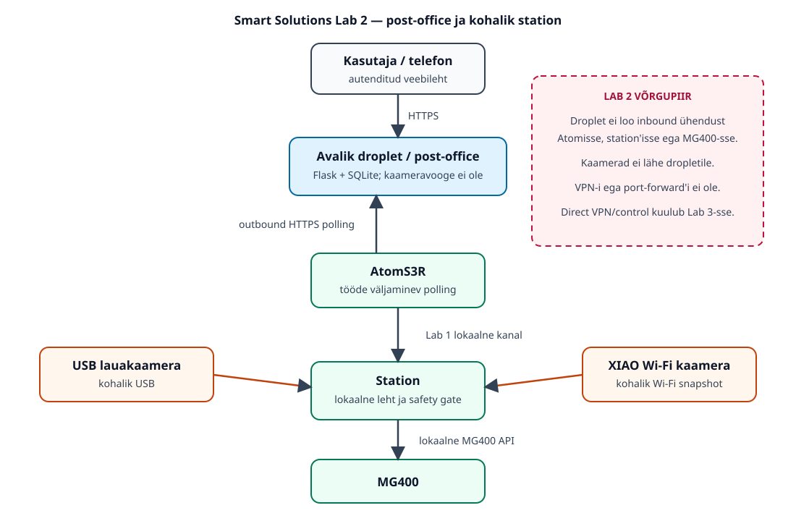

# Nutikad Lahendused: Labor 2 — internetipostkontor ja kaks kaamerat

> See on tööleht, mitte valminud süsteemi kirjeldus. Dropleti, võrgu, roboti,
> kaamerate ja AtomS3 päriskatsed on tegemata, kuni nende juures on kirjas
> mõõtmise kuupäev, meetod ja tegelik tulemus.

**Töömaht:** 28 tundi | **Hindamine:** 20 punkti | **Meeskond:** 3 tudengit

**Välja antud:** 07.10.26 | **Tellimise kuupäev:** 16.10.26 | **Esimene kaitsmine:** 27.10.26, veebis

## Eesmärk

Labor 2 lisab Labori 1 lokaalsele Atom → jaam → MG400 ahelale internetis
kättesaadava postkontori. Kasutaja loob autentitud HTTPS-lehel kõrgtaseme
töö. Atom küsib dropletilt töid väljamineva polling-ühendusega ja annab need
Laborist 1 pärit lokaalse kanali kaudu jaamale. Ainult jaam suhtleb MG400-ga.

Lisaks tuleb jaama lehele kaks kohalikku kaamerapilti: laua üldvaade ja
tööriista juures olev lähivaade. Kaameravood ei lähe dropleti postkontorisse.

Smart Solutions Lab 2 ei ava jaama lehte dropleti kaudu ega loo dropleti ja
jaama vahele VPN-i, SSH pöördtunnelit või muud otsejuhtimise teed. Atom küsib
ise dropletilt töid. Otsene kaugjuurdepääs jaamale kuulub Smart Solutions
Lab 3 ulatusse.

Labor 1 jääb muutmata lähtebaasiks:

- `smart-solutions/lab1/src/station.py` sisaldab jaam → MG400 täitmisrada;
- `smart-solutions/lab1/docs/letter_channel.md` kirjeldab Atomi lokaalset
  HTTP/USB kanalit, korduste tuvastamist ja ohutusväravaid;
- Labori 1 Atomi püsivara ning sama seadete/testide leht on edasise töö alus;
- Labori 1 MG400 ohutusreeglid kehtivad täielikult edasi.

Kavandatud andmevoog:

```text
kasutaja brauser --HTTPS--> dropleti postkontor <--polling-- Atom
                                                           |
                                              Labori 1 lokaalne kanal
                                                           v
                                                         jaam --> MG400

lauakaamera -------- kohalik võrk/USB --------> jaama leht
tööriistakaamera ---- kohalik Wi-Fi ----------> jaama leht
```



Muudetav skeem: [`docs/system.drawio`](docs/system.drawio). Skeem näitab eraldi
avalikku postkontorit, Atomi väljaminevat pollingut, lokaalset robotirada ja
ainult station'i lehele minevaid kaameravooge.

Täpne protokoll on failis [`docs/server_api.md`](docs/server_api.md).
Kohalik kaamera-arhitektuur ja tulevaste pärismõõtmiste metoodika on failis
[`docs/cameras.md`](docs/cameras.md).

## Püsivara töövoog

AtomS3 püsivara arendatakse, ehitatakse ja laaditakse seadmesse PlatformIO
abil. Lab 2 muudatused peavad jääma reprodutseeritavasse PlatformIO projekti:
`platformio.ini`, lähtekoodipuu ja fikseeritavad sõltuvused. Arduino IDE ei
ole selle repo peamine projektitöövoog.

XIAO ESP32S3 Sense tööriistakaamera on eraldi PlatformIO projektis
`firmware-xiao-camera/`; see ei ole AtomS3 projektiga kokku segatud. Mõlemal on
oma `platformio.ini`, lähtekoodipuu ja native-testid. Lab 2 AtomS3 projekt on
kaustas `firmware/`; Labori 1 püsivara ei ole tervikuna kopeeritud. Mõlema
projekti `pio run` build on tarkvaraliselt kontrollitud. AtomS3R-i Lab 2
püsivara laaditi 12.10.26 PlatformIO-ga seadmesse; Atomi autentitud lokaalne
polling, reboot-persistence ja Wi-Fi reconnect kontrolliti 13.10.26. XIAO
upload ja ülejäänud riistvarakatsed on TODO.

## Tehtud töö

See jaotis võtab kokku repos tegelikult valminud ja tarkvaraliselt kontrollitud
Lab 2 osad. See ei kirjelda tulevikuplaani ega tõenda veel dropleti, robotit või
füüsilisi seadmeid kasutavat katset.

### Postkontori server

- Valmis on Flaski ja SQLite'i kasutav postkontor, kus autentitud kasutaja saab
  luua lubatud kõrgtaseme `letter` töid.
- Atomil on kasutajaliidesest eraldatud bearer-võtmega polling- ja tulemuse API.
- Server rakendab TTL-i ja aegumist, lubatud tööde whitelist'i, atomaarset
  claim'i ning idempotentset tulemust. Tundmatuid töid, otseliikumiskäske ja
  kasutaja antud trajektoore järjekorda ei lubata.
- SQLite'is säilivad töö, tulemus ja Atomi `last_seen` olek. Sama töö
  kordussaatmine ei käivita kontrollimatut uut täitmist.
- Sama API-ga mock Atom võimaldab serveri töövoogu kontrollida ilma AtomS3R-i,
  station'i või MG400-ta. Serveri käitumine on kaetud Python testidega.
- Päris dropletile ei ole serverit veel paigaldatud.

### AtomS3R Lab 2 püsivara

- Kaustas `firmware/` on PlatformIO projekt: environment `atoms3r` kasutab
  ühilduvat `m5stack-atoms3` board definition'it.
- Seadete mudel sisaldab serveri URL-i, Atomi privaatvõtit ja polling-intervalli.
  Rakendatud on väljaminev poll/result klient ning production-siht kasutab
  HTTPS-i.
- Aktiivse töö ID ja saatmata terminaltulemus säilitatakse püsivalt. Ühe
  aktiivse töö piir, duplikaadikaitse ja restardi järel ebaselge claim'i
  fail-safe käitumine väldivad automaatset kordustäitmist.
- Atom → station piir saadab Lab 1 väljadega ühilduva serial-JSON sõnumi, millele
  lisatakse stabiilne `job_id`. Native-testid ja PlatformIO build läbivad.
- Lab 2 püsivara laaditi 12.10.26 füüsilisse AtomS3R-i pordi
  `/dev/cu.usbmodem101` kaudu. Esimesel katsel leitud NVS `activeId NOT_FOUND`
  kordus ja development-serveri loopback-bind parandati ning kontrolliti sama
  päeva jätkukatses. Setup-AP, settings, autentitud lokaalne polling,
  reboot-persistence ja Wi-Fi reconnect kontrolliti päris seadmel 13.10.26;
  production HTTPS, station/MG400 ja ametlik mid-job katkestus on TODO.

### Station-adapter

- Valmis on station'i Atom-job adapter, mis säilitab Lab 1 väljad
  `letter/session/seq/atom_sent_ms` ja lisab serveri stabiilse `job_id`.
- SQLite'i idempotentsus, `session + seq` duplikaadikaitse ja restardi
  `ambiguous_after_restart` fail-safe väldivad ebaselge töö automaatset
  korduskäivitust.
- USB serial transport on eraldi abstraktsioon. Mock executor võimaldab
  software-only kontrolli; vaikimisi on täitmine keelatud.
- Adapter ei loo MG400 ühendust ega impordi robotiklienti. Kohalik software E2E
  läbib kogu server → mock Atom → station → server tulemuse ahela.
- Päris MG400 täitmine on TODO ja vajab eraldi lokaalset ohutuskontrolli.

### Station'i kaamerad

- Valmis on ühine kaameraabstraktsioon, USB OpenCV backend ja XIAO HTTP
  snapshot backend.
- Eraldi lokaalne station'i leht näitab kahte kaamerat ning pakub snapshot- ja
  MJPEG route'e. Mock-kaamerad võimaldavad mõlemat rada riistvarata testida.
- Tarkvaralised loendurid mõõdavad kaadrite arvu, väljastatud baite ning
  arvutatud FPS/Mbit/s väärtusi; need ei ole füüsiliste kaamerate mõõtetulemused.
- Kaamerakiht ja route'id on kaetud testidega. Päris USB- ja XIAO-kaameraid ei
  ole selle Lab 2 töövooga füüsiliselt kontrollitud.

### XIAO ESP32S3 Sense

- Kaustas `firmware-xiao-camera/` on eraldi PlatformIO projekt ametliku
  `seeed_xiao_esp32s3` boardiga.
- Teostatud on camera init alus, toetatud sensori tuvastamine, PSRAM-i arvestav
  seadistus, piiratud Wi-Fi reconnect/backoff ning endpoint'id `/status` ja
  `/snapshot.jpg`.
- HTTP leping sobib station'i XIAO snapshot backendiga. PlatformIO build ja
  native-testid läbivad.
- **Püsivara ei ole füüsilisse XIAO ESP32S3 Sense seadmesse üles laaditud ega
  päris kaameraga testitud.**

### Dropleti paigalduse alus

- Valmis on olemasoleva Flaski rakenduse Gunicorn WSGI entrypoint, localhosti
  bind'iga systemd unit ja Caddy HTTPS reverse proxy näidis.
- Lisatud on placeholder'itega env/saladuste muster ning install-, update-,
  verify- ja backup-skriptid. SQLite asub kavandis lähtekoodipuust väljas ning
  backup kasutab SQLite'i turvalist backup API-t.
- Paigalduse staatilised ja lokaalsed testid kontrollivad muu hulgas localhost
  bind'i, fail-closed saladusi, Caddy piiri ja backup'i terviklikkust.
- Päris dropletile paigaldust, avalikku HTTPS-katset, tulemüüri sisselülitamist
  ega SSH hardening'ut ei ole tehtud.

## Tarkvaralise kontrolli tulemused

Kontrollid käivitati lokaalselt 12.10.26 seisuga commit'i
`9ec062661591fd0f7c381134b2702bb76efd3849` sisule või vahetult enne selle
loomist sama sisuga tööpuule:

| Kontroll | Tegelik tulemus | Piirang |
| :--- | :--- | :--- |
| Lab 2 Python `pytest` | 63 testi läbis | software-only; sisaldab 7 deployment-testi |
| `python -m src.e2e_demo` | `server_status=done`, sama `job_id` kogu ahelas, `hardware_used=false` | ajutine DB, mock Atom ja mock executor |
| AtomS3R `pio run` | SUCCESS, environment `atoms3r` | build; upload'i ei tehtud |
| AtomS3R `pio test -e native` | 12/12 testi läbis | hosti native-testid, mitte seadme test |
| XIAO `pio run` | SUCCESS, board `seeed_xiao_esp32s3` | build; upload'i ei tehtud |
| XIAO `pio test -e native` | 6/6 testi läbis | hosti native-testid, mitte kaamerakatse |
| WSGI import ja deploy shell syntax | läbis | lokaalne/static kontroll |
| `deploy/verify.sh` arendusmasinas | `SKIP` | systemd/Caddy production-kontroll vajab päris Ubuntu dropletit |
| Mock-kaameraserver | leht ja API vastasid; mõlemad mock-kaamerad olid saadaval ning mõlemad snapshot'id vastasid | sünteetilised mock-kaadrid, mitte füüsiline mõõtmine |

Tabeli software-only tulemused ise ei tõenda seadme upload'i, MG400 täitmist,
päris kaamerate tööd, internetist kättesaadavat HTTPS-i, SSH hardening'ut ega
tulemüüri olekut. Hilisem osaline AtomS3R upload/boot-katse on eraldi kirjas
12.10.26 arenduspäeviku riistvarakande juures; XIAO upload on endiselt TODO.

## Kontrollnimekiri

Kõik punktid on alguses lahti. Märge tehakse alles pärast kontrollitavat
tulemust; füüsilise katse juurde lisatakse kuupäev, meetod ja failiviide.

### Tarkvaraliselt ettevalmistatav

- [x] Postkontori kasutajaleht ja Atomi API on loogiliselt eraldatud.
- [x] Kohalik kasutajaleht nõuab autentimist; production-siht on endiselt HTTPS.
- [x] Postkontor võtab vastu ainult whitelist'is olevaid kõrgtaseme töid.
- [x] `letter` on ainus praegu lubatud ja tarkvaraliselt teostatud kõrgtaseme
  robotitöö.
- [ ] Teine lubatud kõrgtaseme töö on veel realiseerimata / valimata.
  `pick_place` on ainult tuleviku placeholder ja server lükkab selle praegu
  tagasi; seetõttu ei ole ametlik „vähemalt kaks eri tööd“ kriteerium täidetud.
- [x] Töödel on TTL; aegunud töö märgitakse `expired` ja seda ei väljastata.
- [x] Vigane või tundmatu töö lükatakse tagasi ega jõua täitmispiirini.
- [x] Stabiilne töö ID, atomaarne claim ja idempotentne tulemus välistavad
  sama töö kontrollimatu kordusväljastuse.
- [x] Atom API on väljamineva pollingu jaoks; droplet ei loo ühendust
  Atomi, jaama ega robotiga.
- [x] Poll uuendab heartbeat-/olekuinfot; leht näitab `last_seen` põhjal
  online/offline olekut, roboti olekut ja polling-intervalli.
- [x] Sama terminaltulemuse kordussaatmine sama töö ID-ga on serveris idempotentne.
- [x] Postkontori API leping on kirjas failis `docs/server_api.md`.
- [x] Kohalik Flask postkontor, SQLite store ja minimaalne kasutajaleht on teostatud.
- [x] Mock Atom kasutab sama HTTP API-t ja simuleerib lokaalse jaama tulemust,
  kuid ei kasuta AtomS3 ega MG400-t.
- [x] Automaattestid katavad autentimise, valideerimise, TTL-i, claim'i,
  idempotentsuse, tulemused ja `last_seen` oleku.
- [x] Atomi olemasoleva lehe Lab 2 väljad ja testid on kirjeldatud failis
  `docs/atom_page.md`.
- [x] AtomS3 PlatformIO projekt build'ib ning hostitestid katavad töö- ja
  konfiguratsioonivalideerimist ning ühe aktiivse claim'i reeglit.
- [x] Atom pollib millis-ajastusega, lubab ainult `letter` töö ning salvestab
  aktiivse ID ja saatmata terminaltulemuse püsivalt enne retry'd.
- [x] AtomS3 minimaalne seadeteleht salvestab serveri URL-i, bearer-võtme ja
  polling-intervalli; saladust ei tagastata ega logita.
- [x] Lab 2 station-adapter valideerib firmware serial-JSON lepingu ja kasutab
  Lab 1 `session + seq` korduskaitset koos stabiilse `job_id` väärtusega.
- [x] Station'i SQLite store säilitab terminaltulemuse ja muudab restardist
  jäänud poolelioleva töö `ambiguous_after_restart` keeldumiseks.
- [x] Mock executor ning lokaalne end-to-end demo kontrollivad server → mock
  Atom → station → server ahelat ilma AtomS3 või MG400-ta.
- [x] Ohutuskokkuleppe mustand on failis `docs/safety.md`.
- [x] BOM-i kontroll-leht on failis `docs/bom.md`.
- [x] Mõõtmiste CSV-mallid sisaldavad ainult päiseid, kuni päris mõõtmised on tehtud.
- [x] Station'i eraldi kohalik kaameraserver näitab kahte jagatud worker'iga
  MJPEG-allikat ning ei lisa kaameraroute'e dropleti postkontorisse.
- [x] Mock table/tool allikad, USB OpenCV backend ja seadistatava URL-iga XIAO
  snapshot backend on automaattestitavad ilma riistvarata.
- [x] Software kaadriloendurid ja väljastatud baitide/FPS/Mbit/s arvutus on
  valmis; need ei ole päris kaameramõõtmised.
- [x] XIAO ESP32S3 Sense tool-camera on eraldi PlatformIO projekt ametliku
  `seeed_xiao_esp32s3` boardiga; build ja native-testid läbivad.
- [x] XIAO `/status` ja `/snapshot.jpg` leping sobib station'i olemasoleva
  snapshot backendiga; Wi-Fi saladused jäävad ignored private header'isse.
- [x] Production-paigalduse tarkvaraalus sisaldab localhost Gunicorn unit'it,
  Caddy HTTPS reverse proxy näidist, kaitstud env-malli, SQLite backup'i ning
  install/update/verify skripte. Päris droplet ja sertifikaat on endiselt TODO.

### Vajab õppejõult dropleti/hosti

- [ ] Igal kasutataval arvutil on oma SSH võtmepaar; privaatvõtmeid ei jagata
  ega lisata reposse.
- [ ] Õppejõult on saadud droplet ja hostinimi/alamdomeen või alamtee.
- [ ] Droplet töötab: võtmega sisselogimine, parooliga SSH-sisselogimine
  keelatud, uuendused paigaldatud ja tulemüüris ainult vajalikud pordid.
- [ ] Domeen/host viitab dropletile ja kasutajaleht töötab kehtiva HTTPS-iga.
- [ ] Kasutajalehe autentimine on päriselt kontrollitud.
- [ ] Telefoni mobiilse andmesidega avaneb dropleti postkontori kasutajaleht,
  Wi-Fi on välja lülitatud.
- [ ] Atom pollib production-hostilt töid ning autentimine toimib seadmesse
  salvestatud võtmega, mida repos ei ole.
- [ ] Dropleti taastamine märkmete järgi on läbi proovitud ja tulemus dokumenteeritud.

### Vajab päris riistvara või laborikatset

- [ ] `letter` töö jõuab postkontorist Atomi ja Labori 1 kohaliku kanali kaudu
  jaama ning käivitab lubatud MG400 täitmisraja.
- [ ] Teine whitelist'i töö on riistvaraga integreeritud ja kontrollitud.
- [ ] 30 sõnumit on mõõdetud kiire polling-intervalliga failis
  `docs/latency_poll_fast.csv`.
- [ ] 30 sõnumit on mõõdetud aeglase polling-intervalliga failis
  `docs/latency_poll_slow.csv`.
- [ ] Mõlema 30 katse seeria keskmine ja maksimum on arvutatud pärisandmetest.
- [ ] Internetiühendus katkestatakse töö ajal kontrollitud katses ning
  kontrollitakse, et station lõpetab juba vastu võetud tervikliku töö lokaalselt,
  Atom säilitab tulemuse ja saadab selle pärast ühenduse taastumist.
- [ ] Katkestuskatse on tehtud ohutult kolm korda enne internetist tööde vastuvõttu.
- [ ] Atom `last_seen`/offline kuvamine on päris katkestusega kontrollitud.
- [ ] Laua UHD-kaamera näitab kogu tööala, ruudustikku servast servani ja robotit.
- [ ] Tööriistakaamera näitab otsikut ning selle all olevat detaili.
- [ ] Mõlemad kaamerapildid on jaama lehel ja sama autentimise taga.
- [ ] Kaameraid ei saa postkontori kaudu ega internetist otse avada; Lab 2
  postkontor ei vahenda kaameravooge.
- [ ] Mõlema kaamera lahutus, viide, FPS ja ribalaius on mõõdetud failis
  `docs/camera_metrics.csv`.
- [ ] Roboti juhtimislatentsus on mõõdetud ilma kaamerata, ühe kaameraga ja kahe
  kaameraga failis `docs/control_latency_cameras.csv`.
- [ ] Rõhuanduri kalibratsioonikonstandid on Andmehõive Lab 2 tulemustest
  lisatud Atomi seadetele.
- [ ] Atomi rõhutest näitab korraga toorest ADC lugemit, pinget ja kPa väärtust.
- [ ] Atomi lehe uued väljad, salvestamine ja testinupp on päris seadmel kontrollitud.
- [ ] Ohutuskokkulepe on kõigil meeskonnaliikmetel päriselt läbi loetud ja
  kinnitused on lisatud `docs/safety.md` faili.
- [ ] Enne tellimist on BOM laboris üle kontrollitud ja tellimus on valmis 16.10.26.
- [ ] Repo ja arenduspäevik on täidetud ning esitamisel on loodud tag
  `smart-solutions-lab2`.

### Enne päris riistvara testi

- [ ] BOM-i füüsiline saadavus on laboris kontrollitud.
- [x] Lab 2 püsivara on AtomS3R-i PlatformIO kaudu üles laaditud 12.10.26.
- [x] AtomS3R ja lokaalne postkontor on koos kontrollitud ilma MG400
  täitmiseta.
- [ ] Dropleti ligipääsuandmed ja host on õppejõult saadud.
- [ ] XIAO ESP32S3 Sense füüsiline saadavus on kontrollitud.
- [ ] USB UHD-kaamera füüsiline saadavus on kontrollitud.
- [ ] Andmehõive Lab 2 päris rõhukalibratsioon on kättesaadav.
- [ ] 3D Printing Lab 2 laua- ja tööriistakaamera kinnitused on valmis ning
  füüsiliselt kontrollitud.

## Kavandatud tulemused

| Tulemus | Väärtus või olek |
| :--- | :--- |
| Dropleti host, piirkond ja suurus | TODO — õppejõu host required |
| Avalikud pordid ja põhjendus | TODO — droplet configuration required |
| HTTPS URL | TODO — droplet/domain required |
| Kiire polling-intervall | TODO — real test setting required |
| Kiire pollingu latentsus, keskmine / max | TODO — real measurement required |
| Aeglane polling-intervall | TODO — real test setting required |
| Aeglase pollingu latentsus, keskmine / max | TODO — real measurement required |
| Katkestuse tegelik tulemus | TODO — real laboratory test required |
| Atomi offline-piir | TODO — tested poll interval required |
| Lauakaamera lahutus / viide / FPS / ribalaius | TODO — real measurement required |
| Tööriistakaamera lahutus / viide / FPS / ribalaius | TODO — real measurement required |
| Juhtimislatentsus 0 / 1 / 2 kaameraga | TODO — real measurement required |
| Rõhu kalibratsioonikonstandid | TODO — Data Acquisition Lab 2 result required |
| Riistvara olemasolu ja puuduvad osad | TODO — physical inventory required |

## Kohalik postkontor

Kood asub kaustas `server/`. Valitud on Python, Flask ja standardteegi SQLite.
SQLite hoiab töö ID-d, claim-olekut, terminaltulemust ja Atomi `last_seen`
väärtust ka serveri taaskäivituse järel. See annab idempotentsusele püsiva
aluse ilma eraldi production-andmebaasi halduseta.

Tarkvaralised vaikeväärtused on arenduseks, mitte labori lõplikud otsused:

- töö TTL: 60 s, seadistatav `JOB_TTL_SECONDS` abil;
- maksimaalne lubatud TTL: 3600 s, seadistatav `JOB_MAX_TTL_SECONDS` abil;
- stale/offline piirid: 10 s / 30 s, seadistatavad `ATOM_STALE_SECONDS` ja
  `ATOM_OFFLINE_SECONDS` abil;
- final TTL ja online/stale/offline piirid: TODO — real test/decision required.

### Korratav kohalik käivitus

Käivita käsud kaustas `smart-solutions/lab2/`:

```bash
python3 -m venv .venv
source .venv/bin/activate
python -m pip install -r server/requirements.txt
export ATOM_API_KEY=local-dev-only-atom-key
export POST_OFFICE_USER=dev-user
export POST_OFFICE_PASSWORD=local-dev-only-user-password
python -m server.app
```

Need väärtused on ainult lokaalse arenduse näited, mitte production-saladused.
Ilma `ATOM_API_KEY` või `POST_OFFICE_PASSWORD` muutujata server ei käivitu.
Kasutajaleht avaneb aadressil `http://127.0.0.1:5001/` ja küsib HTTP Basic
kasutajat/parooli. HTTP on lubatud ainult lokaalseks arenduseks.

Füüsilise Atomi samas LAN-is testimiseks tuleb development-server eraldi ja
teadlikult LAN-ile bind'ida:

```bash
export POST_OFFICE_BIND=0.0.0.0  # development LAN test only
python -m server.app
```

Vaikeväärtus jääb `127.0.0.1`. Seda opt-in'i ei kasutata production'is:
systemd/Gunicorn kuulab endiselt ainult `127.0.0.1:5001` ning avalik HTTPS piir
on Caddy.

Loo teises terminalis testtöö:

```bash
curl -u dev-user:local-dev-only-user-password \
  -H 'Content-Type: application/json' \
  -d '{"job":"letter","arg":{"letter":"A"},"ttl_seconds":60}' \
  http://127.0.0.1:5001/api/jobs
```

Polli ja simuleeri Atom → lokaalne station → tulemus piir ilma MG400-ta:

```bash
export ATOM_API_KEY=local-dev-only-atom-key
python -m server.tools.mock_atom --once --outcome done
```

Seejärel vaata tulemust kasutajalehelt või `GET /api/jobs/<id>` kaudu.
Kunstliku pollingu viite jaoks kasuta näiteks `--poll-delay 2`. Keeldumise
simulatsiooniks kasuta `--outcome refused`.

## Kohalik station-adapter

Kood asub kaustas `src/`. See kasutab Lab 1 USB sõnumi välju
`letter/session/seq/atom_sent_ms`, lisab kohustusliku serveri `job_id` ning
tagastab firmware'ile `post_office_result` JSON rea. Adapter ei kopeeri Lab 1
Flask UI-d ega motion-koodi: mock executor kontrollib toetatud tähte otse Lab 1
kanonilisest `config/letters.json` failist.

Reaalset porti kasutava software-only mock adapteri näidiskäsk:

```bash
python -m src.station_adapter --port COM4 --baud 115200 --allow-mock-jobs
```

Ilma `--allow-mock-jobs` liputa on lokaalne täitmine keelatud. Ka lipuga
kasutatakse ainult mock executor'it; MG400 klienti ei impordita ega ühendata.
Serial-porti tohib omada ainult üks programm. Porti kadumisel proovib adapter
uuesti ühenduda, vigane üksikrida ei lõpeta protsessi.

Täielik lokaalne tarkvarademo loob ajutise Flask/SQLite postkontori, pollib
töö mock Atomina, saadab firmware-formaadis rea station-adapterile ning
tagastab sama ID terminaltulemuse serverisse:

```bash
python -m src.e2e_demo
```

Demo kasutab ainult ajutisi placeholder-saladusi ja kustutatavaid SQLite
faile. See ei ava serial-porti, võrguühendust ega MG400 klienti.

## Kohalik kaameraleht

Kaamerakiht asub `src/cameras/` ja eraldi kohalik Flask-rakendus failis
`src/camera_server.py`. Riistvarata demo käivitatakse Lab 2 juurkaustast:

```bash
python -m src.camera_server --mock
```

Leht on aadressil `http://127.0.0.1:5002/`. See näitab kõrvuti Table camera
ja Tool camera mock-pilte, allika olekut, resolutsiooni ning tarkvaralisi
FPS/ribalaiuse loendureid. Demo ei pöördu dropleti, MG400 ega päris kaamera
poole ja ei ava brauserit automaatselt. Päris USB- ja XIAO-seaded, kohalik
autentimine ning kõik mõõtmised on TODO; täpsemalt vt `docs/cameras.md`.

Testid ja import-/süntaksikontroll:

```bash
pytest -q
python -m compileall -q server src tests
```

## Production-paigalduse alus

Korduvkasutatavad production-mallid ja samm-sammuline värske Ubuntu dropleti
paigaldus-, SSH/tulemüüri-, uuendus-, backup-, taastamis- ning kontrolljuhend
on failis [`deploy/README.md`](deploy/README.md). Kavandatud avalik ahel on:

```text
Internet -> HTTPS Caddy -> 127.0.0.1:5001 Gunicorn/Flask -> SQLite
AtomS3  -> outbound HTTPS polling -> sama Caddy host
```

Gunicorn ei kuula avalikul liidesel ning SQLite, env ja backup'id asuvad Git
checkout'ist väljaspool. Dropletile ei lisata station'i, MG400 ega kaamerate
route'e, proxy't, VPN-i või tunnelit. Need failid on kontrollitav deployment
foundation, mitte väide päris dropleti valmimise kohta: DNS, sertifikaat,
serveri hardening, firewall ja recovery drill vajavad endiselt päris hosti.

### Arenduspäevik

**KAARDISTA ISE — päevik.** Üks sissekanne iga töösessiooni kohta, kirjutatud
nii, et inimene, kes kohal ei olnud, saab aru. Sissekandeid lisatakse, mitte
ei muudeta.

**PP.KK.AA — kes olid kohal**

* Tegime:
* Juhtus (numbrid):
* Otsustasime, ja miks:
* Lahti järgmiseks korraks:

**11.10.26 — Nikita**

* Tegime: Valmistasin ette ja viisin software-foundation'i tasemele Flaski +
  SQLite'i postkontori, autentitud Atomi polling/result API, TTL/expiry ja
  idempotentsuse, AtomS3R PlatformIO polling-püsivara aluse, station'i
  job-adapteri ja kaamerakihi, XIAO ESP32S3 Sense PlatformIO kaamerapüsivara
  aluse ning Gunicorni, systemd ja Caddy näidetega dropleti paigaldusaluse.
  Lisasin regressioonitestid ja software-only E2E kontrolli. Füüsilist
  riistvara ega päris dropletit selles töös ei kasutatud.
* Juhtus (numbrid): Python: `63 passed`; deployment-testid: `7/7`; Atomi
  native-testid: `12/12`; XIAO native-testid: `6/6`; mõlemad PlatformIO buildid:
  `SUCCESS`; software E2E: `server_status=done`, `hardware_used=false`.
* Otsustasime, ja miks: Atom algatab dropleti suunas väljamineva pollingu ning
  droplet ei loo otseühendust station'i ega MG400-ga. Internetist võetakse vastu
  ainult kõrgtaseme töid, kaamerad jäävad lokaalsesse võrku ning direct
  control/VPN kuulub Lab 3-sse. Atom ja XIAO kasutavad kohustuslikult
  PlatformIO-d, saladused jäävad repost välja ning ebaselge või korduv töö
  lõpetatakse fail-safe keeldumisega, mitte robotiliikumise kordamisega.
* Lahti järgmiseks korraks: AtomS3R-i päris upload ja lokaalne polling-katse,
  päris droplet, MG400 integratsioon, teine kõrgtaseme töö, füüsilised kaamerad
  ning Andmehõive Lab 2 rõhukalibratsioon.

**12.10.26 — Nikita**

* Tegime: Viisin Lab 2 README Lab 1-ga samasse struktuuri ja stiili ning
  kontrollisin kõigi kolme kursuse Lab 2 README vormingute kooskõla. Tegin Smart
  Solutions pre-hardware auditi: kontrollisin faile `docs/server_api.md`,
  `docs/atom_page.md`, `docs/safety.md`, `docs/bom.md`, mõõtmiste CSV-malle ja
  juurfaili `AGENTS.md`. Lisasin süsteemiarhitektuuri failid
  `docs/system.drawio` ja `docs/system.svg`, dokumenteerisin Andmehõive ja 3D
  Printing sõltuvused ning märkisin puuduva teise kõrgtaseme töö selgeks
  blocker'iks.
* Juhtus (numbrid): `git diff --check` läbis; `4` measurement CSV-malli
  sisaldavad ainult päiseid; lubatud kõrgtaseme robotitöid on `1` (`letter`);
  teine töö on `TODO`; loodud süsteemiskeemi faile on `2` (`system.drawio` ja
  `system.svg`). Need arvud on dokumentatsiooni- ja tarkvarafaktid, mitte
  füüsilised mõõtmistulemused.
* Otsustasime, ja miks: Lab 2 dokumentatsioon järgib Lab 1 vormingut ning
  füüsilised tulemused jäävad TODO-ks kuni päris mõõtmiseni. Rõhukalibratsioon
  tuleb Andmehõive Lab 2-st ning kaamerate füüsiline kinnitus ja FOV sõltuvad 3D
  Printing Lab 2-st. `pick_place` ei ole teostatud töö enne tegelikku lubamist
  ja kontrolli; tag luuakse alles pärast täielikku lõppkontrolli.
* Lahti järgmiseks korraks: ühendada päris AtomS3R, laadida Lab 2 püsivara
  PlatformIO-ga, kontrollida serial boot'i ja Atomi web/settings lehte, testida
  lokaalset postkontori pollingut ning hiljem teostada ja kontrollida teine
  kõrgtaseme töö.

**12.10.26 — Nikita (AtomS3R hardware test)**

* Tegime: Ehitasin Lab 2 `atoms3r` environment'i, tuvastasin ühendatud seadme
  PlatformIO abil ning laadisin püsivara füüsilisse AtomS3R-i. Vaatasin serial
  logi 115200 baudiga, käivitasin lokaalse Flask post-office'i development-only
  saladustega ja kontrollisin `/health` kättesaadavust nii loopback- kui ka
  sülearvuti LAN-aadressil. Peatasin katse enne Atomile Wi-Fi või API võtme
  sisestamist, sest server ei olnud LAN-ist kättesaadav.
* Juhtus (numbrid): Port oli `/dev/cu.usbmodem101` (USB VID:PID `303A:1001`).
  `pio run -e atoms3r` oli `SUCCESS` ajaga 4,36 s; RAM 50 168 / 327 680 baiti
  (15,3%) ja flash 1 122 541 / 3 342 336 baiti (33,6%). Upload oli `SUCCESS`
  ajaga 22,22 s ning kirjutatud image'i hash kontrolliti. Serialis ei nähtud
  panic'ut ega boot loop'i ja firmware jõudis pollingutsüklisse, kuid logis
  kordus `[E][Preferences.cpp] ... activeId NOT_FOUND` ligikaudu iga 9 ms ning
  `POST poll_failed` ligikaudu kord sekundis; seetõttu ei loetud boot-kontrolli
  puhtalt läbituks. Sülearvuti LAN IP oli `192.168.50.249`. Serveri
  `http://127.0.0.1:5001/health` vastas HTTP 200, kuid
  `http://192.168.50.249:5001/health` ei olnud kättesaadav.
* Otsustasime, ja miks: Praegust production'i localhost-piiri ei muudeta
  varjatult. Füüsilise Atomi lokaalseks arendustestiks on vaja eraldi selgelt
  lubatavat development-bind'i LAN-liidesele, säilitades production'i
  `127.0.0.1` vaikeväärtuse. Enne jätkamist tuleb eemaldada ka puuduva
  `activeId` võtme tekitatud NVS log storm. Web/settings lehte, server-test'i,
  pollingut/`last_seen` väärtust, persistence'it ega Wi-Fi reconnect'i selles
  katses läbituks ei märgitud.
* Lahti järgmiseks korraks: Lisada ja dokumenteerida minimaalne development-only
  LAN-bind, parandada puuduva `activeId` lugemine, korrata puhast serial boot'i,
  avada Atomi setup-AP/web settings, kasutada ainult lokaalset development
  võtit, testida `/health`, päris pollingut ja `last_seen` väärtust ning alles
  seejärel teha reboot persistence ja Wi-Fi reconnect kontrollid. MG400,
  droplet, XIAO, kaamerad ja ametlikud latentsusmõõtmised jäävad sellest katsest
  välja.

**12.10.26 — Nikita (AtomS3R hardware test, jätk)**

* Tegime: Leidsin LAN blocker'i põhjuse funktsioonist `server.app.main`, kus
  development-server kasutas alati `127.0.0.1`. Lisasin piiratud
  `POST_OFFICE_BIND` opt-in'i: default on endiselt loopback ning `0.0.0.0` on
  lubatud ainult teadlikuks development LAN testiks. Production'i Gunicorn ja
  Caddy jäid loopback-piirile. Leidsin NVS flood'i põhjuse funktsioonist
  `PersistentState::activeJobId()`: värskel seadmel normaalset puuduvat
  `activeId` võtit loeti igas võrgutsüklis `getString()` abil. Lisasin enne
  lugemist `isKey()` kontrolli, testisin tarkvara, ehitasin ja laadisin firmware
  uuesti ning kordasin serial- ja LAN-kontrolli.
* Juhtus (numbrid): Python suite: `66 passed`; Atom native-testid: `13/13`;
  Atom build: `SUCCESS` 7,82 s, RAM 50 168 / 327 680 baiti (15,3%), flash
  1 123 057 / 3 342 336 baiti (33,6%). Re-upload pordile
  `/dev/cu.usbmodem101` oli `SUCCESS` 16,25 s ja image'i hash kontrolliti.
  Mitmesekundilises serial-vaatluses ei olnud panic'ut ega reboot loop'i ning
  `activeId NOT_FOUND` log storm kadus täielikult; seadistamata ühenduse
  `POST poll_failed` jäi ligikaudu 1000 ms intervallile. Sülearvuti tegelik LAN
  IP oli endiselt `192.168.50.249`. Explicit `POST_OFFICE_BIND=0.0.0.0` korral
  vastasid nii `http://127.0.0.1:5001/health` kui ka
  `http://192.168.50.249:5001/health` HTTP 200.
* Otsustasime, ja miks: Kaht algset parandust ei laiendatud arhitektuuri
  refactor'iks ega production'i avalikuks bind'iks. Atom ei ilmunud praeguse
  LAN-i ARP-tabelisse ning `Lab2AtomSetup` AP-d ei leitud ka pärast normaalset
  restarti. Tõenäoline põhjus on varasem `wifi` NVS SSID, mille olemasolul
  firmware jääb STA connecting olekusse ega tee setup-AP fallback'i. Salvestatud
  Wi-Fi andmeid ei loetud ega kustutatud ilma eraldi kinnitamiseta. Seetõttu ei
  märgitud settings-lehte, server-test'i, autentitud pollingut, `last_seen`
  väärtust, persistence'it ega reconnect'i läbituks.
* Lahti järgmiseks korraks: Kinnitada turvaline Wi-Fi taastamisviis — kasutada
  teadaolevat salvestatud võrku, kustutada kasutaja loal ainult vana Wi-Fi NVS
  seadistus või lisada eraldi kontrollitud setup-AP fallback. Seejärel avada
  settings-leht, sisestada lokaalne development URL ja võti, kontrollida
  `/health`, autentitud pollingut ja tegelikku intervalli, `last_seen` väärtust,
  reboot persistence'it ning Wi-Fi reconnect'i. MG400, droplet, XIAO, kaamerad
  ja ametlik mid-job disconnect test jäävad endiselt välja.

**13.10.26 — Nikita (AtomS3R Wi-Fi reconnect test)**

* Tegime: Lisasin olemasolevale setup-AP fallback'ile piiratud AP+STA recovery:
  seadistus-AP jääb võrgu taastumise ootamise ajal aktiivseks, salvestatud
  STA-seadistust proovitakse perioodiliselt uuesti ning eduka ühenduse järel
  peatatakse retry ja setup-AP. Ehitasin ja laadisin püsivara päris AtomS3R-i,
  kontrollisin autentitud lokaalset pollingut ja reboot-järgset persistence'it
  ning tegin reaalse 2,4 GHz katkestus- ja taastamiskatse ilma Atomi reboot'ita.
* Juhtus (numbrid): Native-testid läbisid `21/21`; Atom build oli `SUCCESS`,
  RAM 50 176 / 327 680 baiti (15,3%) ja flash 1 127 693 / 3 342 336 baiti
  (33,7%); upload pordile `/dev/cu.usbmodem1101` oli `SUCCESS`. Enne katkestust
  vastas `POST /api/atom/poll` HTTP 200 ligikaudu `1000 ms` intervalliga ning
  `last_seen` uuenes. 2,4 GHz kadumisel lõppes polling, serial näitas esmalt
  reason `51` (`INVALID_FTE`) ja seejärel reason `201` (`NO_AP_FOUND`);
  `15 s` järel oli lõppolek `WL_NO_SSID_AVAIL` ja käivitus `Lab2AtomSetup`.
  Recovery retry intervall oli `20 s` ning ühe STA-katse timeout `15 s`.
  Võrgu taastumise järel assotsieerus Atom järgmisel retry-katsel, sai uuesti
  aadressi `192.168.50.19` ja polling jätkus automaatselt HTTP 200-ga;
  `last_seen` uuenes väärtuselt `2026-10-12T22:16:20.330494Z` väärtusele
  `2026-10-12T22:16:24.333387Z`. Käsitsi raadio sisselülitamise hetke ei
  timestamp'itud Atomiga samast kellast, seega täpset taastumisaega sekundites
  ei esitata. Panic'ut, reboot loop'i ega NVS log storm'i ei olnud.
* Otsustasime, ja miks: Fallback kasutab AP+STA režiimi, et setup-leht jääks
  kättesaadavaks, kuid retry ei muutuks tight loop'iks. SSID-d, Wi-Fi parooli,
  serveri URL-i, Atomi võtit ega pollinguseadeid katkestuse ajal ei kustutata.
  Edukas STA taastumine lõpetab recovery-oleku ja tavapolling jätkub ilma
  reboot'ita. Development-võtit ega muid saladusi päevikusse ei lisata.
* Lahti järgmiseks korraks: Ametlik mid-job katkestuskriteerium koos aktiivse
  töö ja saatmata tulemuse NVS retry-ga, production droplet/HTTPS, päris MG400,
  kaamerad, latentsusmõõtmised ja Andmehõive rõhukalibratsioon jäävad TODO-ks.

### Väljundid ja tulemused

**Väljundid**
* Lab 3 saab siit postkontori tarkvara ja dropleti paigaldusaluse; päris dropleti
  paigaldus ja taastamiskatse on TODO — droplet required.
* Lab 3 saab siit Atomi väljamineva pollingu ning lokaalse `letter` tarkvaralepingu;
  AtomS3R upload ja autentitud lokaalne polling on tehtud, kuid MG400
  riistvaraintegratsioon on TODO.
* Lab 3 saab siit kahe station'i kaamera lokaalse tarkvarakihi; mõlema päris
  kaamera samaaegne kontroll ja näidispildid on TODO — real hardware required.
* Lab 3 VPN/direct path saab siit postkontori, Atomi, station'i ja kaamerate
  piirid; VPN-i ega station'i otseühendust Lab 2-s ei teostata.

**KAARDISTA ISE, lõpus.**
* Git repo ja tag: TODO — lisada alles esitamisel.
* Numbrid, mille see labor andis, ühikutega: TODO — real measurement required;
  software-testide arvud ei ole füüsilised mõõtmistulemused.
* Postkontori paigaldus- ja taastamismallid: teostatud failis
  `deploy/README.md`; päris dropleti paigaldus on TODO — droplet required.
* Meeskonna ohutuskinnitused: TODO — each team member must confirm personally.
* Mida me teeksime teisiti: TODO — complete after physical tests.
* Mida järgmine labor peaks enne alustamist teadma: TODO — complete at the end
  of Lab 2 after droplet, Atom, MG400 and camera tests.
