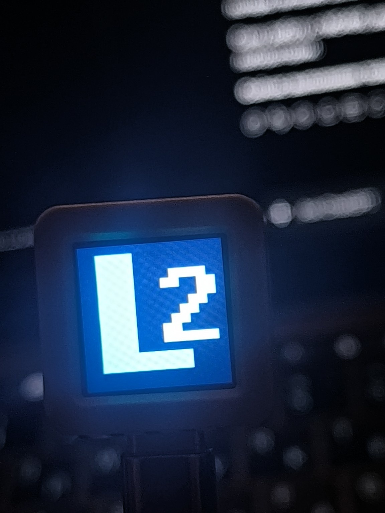
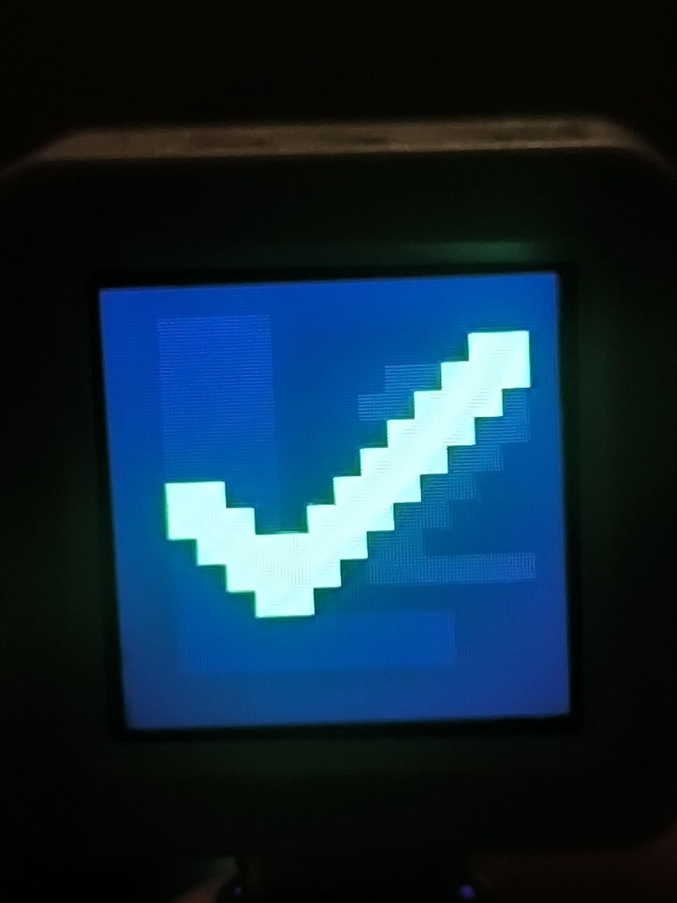

# Atomi LCD päriskatsete tõendid — 06.11.2026

## Katsekeskkond ja tõendite kontroll

Kodune katse ühe füüsilise AtomS3R-iga (MAC `B4:3A:45:BC:CE:84`,
`device_id=atom-84cebc453ab4`). Püsivara: `atoms3r_normal`, `BENCH_MODE=0`,
repo commit `957142c938c2b02477fc6411270e6dff5f4452d3`.
MacBooki olemasolev Flask-postkontor kasutas eraldi test-SQLite'i ja ajutisi
testivõtmeid Xiaomi WPA2 / 2,4 GHz hotspotis. Ühendus oli **kohalik HTTP**;
production-dropletit, StationAdapter'it, MG400-t ega pumpa ei kasutatud.
Teine kodune Atom oli välja lülitatud, labori Atom katses ei osalenud.

Algallikad on Git'ist väljas hoitud privaatsed
`display-image-lab2_logo-first.json` ja `display-image-lab2_check-second.json`,
sama test-SQLite ning serveri HTTP-logi. Mõlemad JSON-id kontrolliti üle ja
võrreldi SQLite kirjetega; failide õigused on `0600`. Siia on kantud ainult
katse kokkuvõte, mitte credentials, täielik logi, andmebaas ega flash-backup.

## Kinnitatud füüsilised tulemused

Enne katseid oli esimese töö jaoks testbaas tühi; teise töö eel oli esimene
juba `done`. Ühe seadme heartbeat oli värske ja `last_seen` uuenes
`1000 ms` polling-seadega. Tuntud mock/Station-protsesse Macis ei leitud.
Iga töö loomiseks saadeti täpselt üks `POST /api/jobs`, TTL `120 s`;
loomise POST-i ei korratud.

| `image_id` | `job_id` | Loomine | Serveri terminaltulemus | LCD kasutaja visuaalse kinnituse järgi |
| :--- | :--- | :--- | :--- | :--- |
| `lab2_logo` | `b9ceab63fa7a427583f2c8ec4a3e6c9a` | HTTP 201 | `done`, `result.source=local_display` | Oodatud L2-pilt: sinakasroheline L ja valge 2 tumedal taustal |
| `lab2_check` | `ae4ce2cf9cb242aba14d51c6bfd5935d` | HTTP 201 | `done`, `result.source=local_display` | L2-pildi asemel roheline linnuke |

Mõlema töö ajal tulid füüsilise Atomi IP-lt `POST /api/atom/poll` ja
`POST /api/atom/result` vastustega HTTP 200. Sama ID-ga terminaltulemust
kontrolliti `GET /api/jobs/<job_id>` kaudu. Kasutaja kinnitas mõlemad pildid
eraldi vestluses; ainult HTTP `done` ei olnud LCD nähtavuse tõend.
Ekraani automaatset tagasisidet ei kasutatud.

Lõppkontrollis oli test-SQLite'is täpselt **2 tööd**, mõlemad `done`,
allikaga `local_display` ja `reason=null`. Teine katse ei muutnud esimest
töö kirjet ega esimest tõendifaili. Nende kahe töö täitmisvigu ei tuvastatud.
Varasem autentimise 403 lahendati testivõtme kohaliku parandamisega enne
LCD-katseid; võtme väärtust ei avaldata.

## LCD-fotod

07.11.2026 lisati kasutaja esitatud fotod. Mõlema sisu vaadati üle;
paroole ega võtmeid piltidel ei tuvastatud. JPEG-failides ei leitud
EXIF/XMP ega kommentaariplokke. Fotode baite ei muudetud. Need näitavad
LCD-kujutist; töö ID ja serveritulemus on eraldi JSON/SQLite tõendid.

`lab2_logo` — L2-pilt päris Atomi LCD-l:

`lab2_check` — linnuke päris Atomi LCD-l:

## Mida see ei tõenda

- Kaks image ID-d on **ühe töö tüübi** `display_image` kaks argumenti.
  [Ametlik ülesanne](https://github.com/KKallas/Narva-subjects/blob/main/EST/2026-27/Smart%20Solutions/Smart%20Solutions%20%5BLab%202%5D%20EST.md)
  nõuab vähemalt kahte eri tööd, millest üks on Lab 1 `letter`. Selle
  tervikkriteerium ei ole nende LCD-katsetega täidetud.
- Need olid päris LCD-katsed, mitte mock/simulaator. Varasemad software E2E
  `done` tulemused ja pick-place simulatsioon ei tõenda MG400 liikumist.
- Avalikku HTTPS ahelat, telefonist mobiilse andmesidega jäetud töö täitmist,
  võrgu katkemist, reboot'i ja püsiva tulemuse retry'd nende katsetega ei testitud.
- Hotspot'i STA-võrgus Maci GET `/state` ebaõnnestus (`No route to host`),
  kuigi algne setup-AP leht ja GET-id olid Safari kaudu kontrollitud.
  See ei tõenda NVS-viga.
  Pärast esimest terminaltulemust jätkunud edukas polling on koodipõhine
  kaudne kinnitus, et active/pending ei blokeerinud teist tööd; see ei ole
  NVS-i toitekatkestuskatse ega kogu flash'i säilimise tõend.
- JSON-i algus-/lõpuajad ei ole kasutaja vajutusest roboti esimese liigutuseni
  mõõdetud latentsus. Neid ei kanta latency CSV-desse. Kiirust, FPS-i,
  rõhku ega kalibratsioonikonstante siin ei mõõdetud.
- SDK ESP-IDF flash-coredump'i ja OTA metadata varasem jääkrisk säilib.

## Minimaalne järgmine kodune kontroll

Järgmised katsed on **tegemata** ja vajavad eraldi luba; uusi töid selle
raporti koostamisel ei loodud. Kontrollnimekirja alus on eespool viidatud
ametliku ülesande jaotised „Postkontor”, „Kontrollnimekiri” ja „Kaitsmine”.

1. **Aegumine:** jäta eraldi testtöö Atomi vooluta olekus, oota TTL-i
   möödumist ja käivita Atom. Kontrolli `expired` tulemust ning seda, et
   aegunud töö ei kuva uut pilti. Robotiliikumise puudumist kontrollitakse
   `letter` rajal eraldi laboris.
2. **Whitelist:** saada lubamatu töö või image ID. Kontrolli API keeldumist,
   uue töö kirje puudumist ja LCD muutumatust. Koordinaate ega actuator-käske
   ei täideta; kodune keeldumiskatse ei asenda MG400 ohutuskontrolli.
3. **Offline-kuva:** jäta Atom vooluta ja kontrolli lehel `last_seen` ning
   online/stale/offline üleminekut. Pane kirja tegelik aeg ja kasutatud
   piirid; pärast taastumist peab heartbeat uuesti uuenema.
4. **Avalik HTTPS:** pärast eraldi serveriversiooni ja testakna kooskõlastust
   kontrolli päris Atomi autentitud pollingut ning `display_image` tulemust
   avaliku HTTPS kaudu. Kasutajaleht tuleb avada telefonis Wi-Fi väljas,
   mobiilse andmesidega. Avalik järjekord on ühine: päris laboritöid ei tohi
   testiga segada. Kohalik HTTP ei asenda seda katset.

Võrgukatkestuse/pending-result retry kodune eelkatse võib kontrollida Atomi
puhvrit ainult siis, kui tegelik saatmata tulemus on tõendatud; juba serveris
kinnitatud `done` järel võrgu katkestamine ei testi retry'd. NVS/reboot'i
käitumine jääb eraldi kontrollimata. Ametlik **kolm korda keset robotitööd**
tehtav katkestuskatse, päris `letter`, kaks 30-sõnumilist latentsusseeriat
roboti esimese liigutuseni, mõlemad kaamerad ja rõhuandur vajavad endiselt
laborit ning [kohaliku letter-katse ohutusprotseduuri](live_letter_runbook.md).
Lab 2 lõpetatuks ei märgita ja lõplikku tag'i ei looda.
